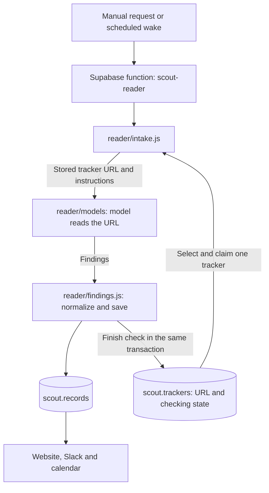

# Scout architecture

This describes the local reader implementation. The hosted functions are deployed; the production schema and website cutover await Firebase reauthentication. Recurring collection and notifications remain paused.

## Tracker investigation

[The Supabase function](../supabase/functions/scout-reader/index.ts) authenticates a backend secret, opens one database connection and calls [intake.js](../reader/intake.js). It accepts a POST without parameters for the next due tracker, or `tracker_id` for an explicit check/retry. The URL is read from that tracker, unchanged. `reader/` runs inside this function; it is not a separate hosted service.

Intake selects and claims a tracker atomically before model HTTP. A 120-second lease excludes overlapping checks. It supplies the URL, current date and [instructions/schema](../reader/instructions.js) to the model. There is no publisher dispatch, page preparation, article inventory, fingerprint check or separate scheduling-research pass. The model can follow relevant links during its investigation. Missing dates do not prevent saving useful findings.

The response is normalized and saved in a transaction that also finishes the tracker check. The lease and unchanged tracker URL are checked before saving. A changed URL resets its state and disables automatic checks until backend enablement. Failed saves roll back the finding and successful completion together.

## Tracker state

Source configuration and current progress live together in `scout.trackers`:

| Field | Meaning |
| --- | --- |
| `next_check_at` | When an enabled tracker becomes eligible again. Success schedules from its cadence. |
| `last_checked_at` | When the last attempt finished, including failure or budget deferral. |
| `last_error` | Short reason for the latest unsuccessful attempt; cleared on success. |
| `failure_count` | Attempts since success, including the current claimed attempt. Three stop automatic retries. |
| `lease_id`, `lease_until` | Temporary ownership of an in-flight check; cleared when finished. |

A terminated worker's attempt remains counted. An explicit tracker-ID request starts another bounded cycle after three failures, without stealing a live lease. `last_checked_at` does not imply successful retrieval; inspect `last_error` too.

There is no stored status enum, permanent completion flag or separate source-state table. The legacy `collector` configuration column remains for the retained scraper files; the reader does not inspect it. The dashboard queries tracker rows directly, with no finding-job backlog view. Browser users cannot write operational state or read lease tokens.

## Findings and model calls

[findings.js](../reader/findings.js) converts the model response into records and saves them under a transaction advisory lock. Records have one `description`, no title, overrides or per-field provenance. Correction endpoints and protected-field merging are removed, without replacing their metadata elsewhere. Existing ordinary finding values and source URLs remain; correction-specific source labels are removed.

The existing description/source matching heuristics remain temporarily: identity aliases, exact descriptions, word overlap and a sole same-kind source candidate. They can misidentify developments; model-directed lookup is separate work. No record catalog is added to the prompt. Responses are currently limited to eight findings. These limitations are not resolved by this refactor.

Identical findings make no record writes. A substantive change increments the version; adding only source URLs or aliases preserves it. Missing optional fields do not erase existing facts. Dates retain their meaning and precision; missing clocks and timezones remain unknown.

[The model gateway](../reader/models/gateway.js) reserves and settles shared usage through existing SQL functions. Gemini uses URL Context; the existing OpenAI fallback uses provider web access. Normally one generation is needed; eligible Gemini failures allow one fallback within the same two-generation allowance. Provider deadlines and uncertain charges remain enforced. Provider errors defer the tracker until its retry time. There is no custom URL validator or canonicalizer in the reader.

There is no quota-policy table, budget-verification expiry or global policy enablement switch. The providers enforce their account limits. The existing reservation table retains current numeric usage, including uncertain requests; bounded cleanup removes rows after their accounting window. Scheduling is controlled by the cron job itself, which remains disabled.

[database.js](../reader/database.js) wraps the Postgres connection with parameterized queries, transactions and per-invocation statement/byte bounds. It returns numeric statement, mutation and byte counters without retaining query parameters or result bodies. It is an internal SQL wrapper, not another network API.

## Other components

- [website/](../website/) displays findings and tracker state. Firebase hosts the static interface; Supabase Auth and RLS protect data. Verified Ocean Agentics Google identities retain reader access and backend-granted admin roles.
- [scout-notify](../supabase/functions/scout-notify/index.ts) calls the existing [Slack workflow](../slackbot/slack.js) for explicitly requested sends. Delivery accounting and uncertain-send protection remain. No notifications are sent during reader checks.
- [scout-calendar](../supabase/functions/scout-calendar/index.ts) retains the existing private subscription feed and explicit Google Calendar synchronization. It reads saved findings.
- [diagnostics/run-reader.js](../diagnostics/run-reader.js) launches a hosted check. Its explicit diagnostic mode runs the local reader with in-memory findings and shared model accounting; see [diagnostics instructions](../diagnostics/README.md).
- [collector/](../collector/), including `discovery/`, is retained for later review/removal. Nothing in the new hosted reader imports it. Legacy database integration tests use the pre-reader schema. The old deployed endpoint becomes HTTP 410 at cutover.

Production stores findings, source URLs and compact current state. Source bodies, prompts, responses and proof trails are not production records. The requested local traffic capture remains confined to diagnostics.

## Cutover and operating cost

Keep all recurring jobs paused. Apply the description-only migration before `20261019200000_scout_reader.sql`, retire the old function, deploy reader/notification functions and the updated website as a coordinated release. Reinstall [scout-loop.sql](../supabase/scout-loop.sql) afterward; it creates the hourly schedule disabled. Do not run the legacy collector against the new schema.

The reader migration drops source-state rows, the backlog function/view, correction columns and the HTTPS-format constraint. It does not convert article URLs into trackers or reconstruct old operational history. It leaves delivery accounting unchanged. The following removal migration drops the quota-policy table; current per-call charges remain in the existing reservation table. Migration guards require paused work, no active source claims or sends, and at most 1,000 records/500 trackers.

Estimated normal activity is one generation, two tracker-row mutations and only changed/new finding writes, plus existing quota accounting. Six fixed state columns replace up to 201 source-state rows per tracker. The current scheduler serves at most one tracker per hourly wake: at most 24 checks/48 generations per day if explicitly enabled. A faster cadence may therefore wait longer when many trackers are due. Manual requests also consume provider allowances.

Local PGlite tests with mocked providers measured 26 counted SQL statements and seven row mutations for a fallback check saving one finding. A one-generation repeat measured 17 statements and four mutations (two tracker and two accounting writes), with no finding write. These tests do not prove live extraction accuracy or current account capacity. Measure one real tracker check before enabling unattended work.
