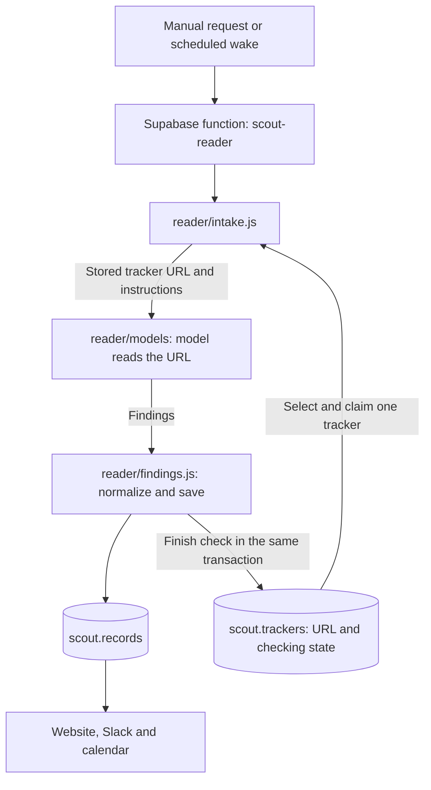

# Scout architecture

The reader, production schema and website were deployed on 19 October 2026. Recurring collection and notifications remain paused.

## Tracker investigation

[The Supabase function](../supabase/functions/scout-reader/index.ts) authenticates a backend secret, opens one database connection and calls [intake.js](../reader/intake.js). It accepts a POST without parameters for the next due tracker, or `tracker_id` for an explicit check/retry. The URL is read from that tracker, unchanged. `reader/` runs inside this function; it is not a separate hosted service.

Intake selects and claims a tracker atomically before model HTTP. A 120-second lease excludes overlapping checks. It supplies the URL, current date and [instructions/schema](../reader/instructions.js) to the model. There is no publisher dispatch, page preparation, article inventory, fingerprint check or separate scheduling-research pass. The model can follow relevant links during its investigation. Missing dates do not prevent saving useful findings.

The response is normalized and saved in a transaction that also finishes the tracker check. The lease and unchanged tracker URL are checked before saving. A changed URL resets its state and disables automatic checks until backend enablement. Failed saves roll back the finding and successful completion together.

## Tracker state

Source configuration and current progress live together in `scout.trackers`:

| Field | Meaning |
| --- | --- |
| `next_check_at` | When an enabled tracker becomes eligible again. Success schedules from its cadence. |
| `last_checked_at` | When the last attempt finished, including failure. |
| `last_error` | Short reason for the latest unsuccessful attempt; cleared on success. |
| `failure_count` | Attempts since success, including the current claimed attempt. Three stop automatic retries. |
| `lease_id`, `lease_until` | Temporary ownership of an in-flight check; cleared when finished. |

A terminated worker's attempt remains counted. An explicit tracker-ID request starts another bounded cycle after three failures, without stealing a live lease. `last_checked_at` does not imply successful retrieval; inspect `last_error` too.

There is no stored status enum, permanent completion flag or separate source-state table. The legacy `collector` configuration column remains for the retained scraper files; the reader does not inspect it. The dashboard queries tracker rows directly, with no finding-job backlog view. Browser users cannot write operational state or read lease tokens.

## Findings and model calls

[findings.js](../reader/findings.js) converts the model response into records and saves them under a transaction advisory lock. Records have one `description`, no title, overrides or per-field provenance. Correction endpoints and protected-field merging are removed, without replacing their metadata elsewhere. Existing ordinary finding values and source URLs remain; correction-specific source labels are removed.

The existing description/source matching heuristics remain temporarily: identity aliases, exact descriptions, word overlap and a sole same-kind source candidate. A live check confirmed that different wording and an index-page URL can duplicate an existing event; the duplicate created by verification was removed. Model-directed lookup is separate work. No record catalog is added to the prompt. All returned findings, descriptions and organizations are normalized without content-count or text-length truncation.

Identical findings make no record writes. A substantive change increments the version; adding only source URLs or aliases preserves it. Missing optional fields do not erase existing facts. Dates retain their meaning and precision; missing clocks and timezones remain unknown.

[The model gateway](../reader/models/gateway.js) makes one Gemini attempt and, for eligible failures, one OpenAI fallback. Gemini uses URL Context; OpenAI uses provider web access. The existing request timeouts remain (45 seconds for Gemini, 100 seconds total); provider errors defer the tracker until its retry time. Explicit diagnostic provider selection disables fallback. There is no generic admission dispatcher or database prerequisite for a model call.

The providers enforce their actual context, output and account limits. Scout does not set request/response byte, output-token, URL, tool-call or finding-count caps. Provider truncation and malformed output fail visibly. There is no model usage ledger, uncertain-charge estimate, application spending limit, reservation/settlement call or quota cleanup. Scheduling is controlled by the cron job itself, which remains disabled.

[database.js](../reader/database.js) wraps the Postgres connection with parameterized queries and transactions. It returns invocation-local SQL statement, mutation and byte measurements without gating work or retaining query parameters or result bodies. It is an internal SQL wrapper, not another network API.

## Other components

- [website/](../website/) displays findings and tracker state. Firebase hosts the static interface; Supabase Auth and RLS protect data. Verified Ocean Agentics Google identities retain reader access and backend-granted admin roles.
- [scout-notify](../supabase/functions/scout-notify/index.ts) calls the existing [Slack workflow](../slackbot/slack.js) for explicitly requested sends. Delivery accounting and uncertain-send protection remain. No notifications are sent during reader checks.
- [scout-calendar](../supabase/functions/scout-calendar/index.ts) retains the existing private subscription feed and explicit Google Calendar synchronization. It reads saved findings.
- [diagnostics/run-reader.js](../diagnostics/run-reader.js) launches a hosted check. Its explicit diagnostic mode reads the tracker once and runs the local reader with in-memory findings, with no shared database writes; see [diagnostics instructions](../diagnostics/README.md).
- [collector/](../collector/), including `discovery/`, is retained for later review/removal. Nothing in the new hosted reader imports it. Legacy database integration tests use the pre-reader schema. The old deployed endpoint returns HTTP 410.

Production stores findings, source URLs and compact current state. Source bodies, prompts, responses and proof trails are not production records. The requested local traffic capture remains confined to diagnostics.

## Cutover and operating cost

The description-only, reader and quota-policy removal migrations are applied in production. The reader, notification and calendar functions and website are deployed. The replacement [scout-loop.sql](../supabase/scout-loop.sql) is installed with its hourly schedule disabled. All four Scout cron jobs remain paused. Do not run the legacy collector against the new schema.

The reader migration drops source-state rows, the backlog function/view, correction columns and the HTTPS-format constraint. It does not convert article URLs into trackers or reconstruct old operational history. The later model-accounting removal migration drops the model ledger and reservation, settlement and expiry functions. Notification delivery state and useful findings remain intact.

The model-accounting removal and content-cap changes are deployed. The updated reader was deployed before applying the removal migration, with recurring work paused. Verification confirmed that all 111 findings, 44 trackers and 12 delivery-state rows retained their values, the model ledger and accounting functions are absent, and all four cron jobs remain paused.

A normal check needs one generation, or two with fallback, and two tracker-row mutations plus changed/new finding writes. Model calls perform no SQL. SQL measurements remain invocation-local. Recurring collection and notifications stay paused; Bluesky pagination and incremental coverage remain a separate proposal.
