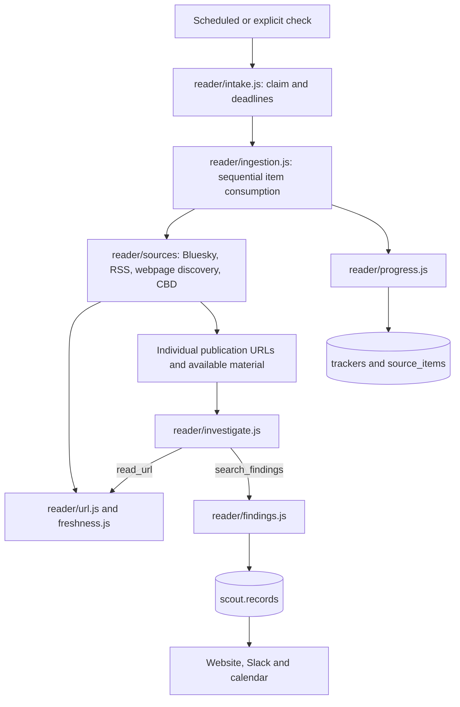

# Scout architecture

Scout saves BBNJ events, announcements and treaty developments in flat findings shared by the website, Slack and calendar. Collection wakes every six minutes and checks one due tracker. The company timezone is America/New_York; stored instants remain UTC and published dates retain their precision. Deployment instructions are in [README](../README.md#supabase-deployment).

## Volunteer review

The website opens on Review for verified Ocean Agentics accounts. [review.js](../website/review.js) shows one unreviewed finding at a time, its description, source links and model ranking, with High/Normal/Low buttons and required notes explaining the ranking. Save stays disabled until the reviewer selects a ranking, enters nonblank notes and opens a source link for that card. Hovering or focusing its disabled wrapper shows a tooltip explaining these requirements. Source buttons lead their row and show opened/unopened states. The click state is browser-only and resets for each card; it is not proof that the source was read. The compact layout keeps source links and controls visible within the viewport; long descriptions scroll inside the card. Desktop places the finding beside the form, and mobile stacks them. [dashboard.js](../website/dashboard.js) owns navigation to Review, Records, Trackers and Calendar; all views share the compact nav with consistent padding and link weights. Direct record links still open Records. Records and tracker inventory load only when those views are first opened. Calendar uses Google's exact shareable link, including its unpadded cid, for the existing Scout Google calendar. Its instructions pair full-header and left-sidebar Google Calendar screenshots from website/public/calendar with control close-ups. CSS markers show the account icon, calendar-list sections and Scout checkbox; a real already-added notification explains that state. These static UI crops exclude personal events, names and email addresses; they do not request an iCal feed link or change sharing permissions.

`scout.review_queue()` returns the next finding and the signed-in reviewer's count. `scout.submit_review(uuid,timestamptz,text,text)` requires nonblank notes, verifies the exact displayed revision, saves feedback and returns the next card and committed count in the same transaction. Previously saved feedback is preserved. Lost-response retries and concurrent submissions cannot create a second review for the same reviewer/finding. A changed or deleted finding requires reloading before submission. Findings already reviewed are not reassigned when edited.

`scout.finding_reviews` stores one row per reviewer/finding: model priority at submission, reviewer priority, notes and submission time. Feedback never overwrites model findings or changes collection, Slack or calendars. Reviewers can read their own feedback; Scout admins can read all feedback. Writes go through the authenticated RPC; neither anonymous nor unverified accounts can access the queue or submit. There are no model calls, scheduled work or separate score counters. Personal counts come from saved reviews. A small count animation follows confirmed saves; each crossed multiple of 12 opens a full-screen celebration, with a static version for reduced-motion preferences.

The same table holds a separate `origin='slack'` class of reference cases for background Triage and ranking analysis. They are not surfaced in the review UI. Existing rows retain `origin='reviewer'` and their reviewer/finding uniqueness; a UUID identifies each row. Slack rows retain a short useful finding description, `source_url`, `slack_url`, `slack_author_id`, `slack_author_name`, `slack_posted_at`, expected `priority`, optional observed `model_priority` and concise notes. They have no reviewer or production-record association, so missed findings can be recorded without creating production findings or attributing a review to the poster. A unique `(slack_url,source_url)` key makes repeated scans write nothing while preserving independent posts of the same source. The existing read policy keeps these cases accessible only to backend/admin analysis; backend access alone can insert them. Volunteer feedback stays private and counts/queues remain unchanged. No browser functions or API calls are added.

The existing daily local Triage automation checks new human postings in public OA Slack channels and inserts only new relevant cases into `finding_reviews`; its other reviews remain read-only. It excludes bots and Scout’s own messages. Successfully completed Slack-posting scans in the Triage chat establish coverage; incomplete scans never advance it and no checkpoint file or scan history is added. Source bodies and message text are read in memory and discarded. Retained descriptions and notes summarize the useful development and the human relevance signal, not transcripts or model traffic. Human sharing is stronger evidence for rubric assessment than a volunteer rating alone, with Aaron’s webinar an expected High reference. No numerical weighting algorithm or automatic rubric/priority changes are introduced. Each run uses two batched database reads plus a batch of inserts for new links, zero separate Scout model calls and no finding, notification, calendar or job writes.

## Shared item ingestion

The authenticated [hosted reader](../supabase/functions/scout-reader/index.ts) reserves one database connection and calls intake. Intake atomically claims a tracker with a 120-second lease, then invokes the shared ingestion service. Source/model work happens outside database transactions. An explicit tracker ID can retry a source that stopped after three unsuccessful attempts, without stealing a live lease.

[Source adapters](../reader/sources/index.js) enumerate publications; they do not decide relevance or match findings. The tracker's collector setting is explicit: web_page (Page), web_index (Index) or bluesky_feed. Page investigates the complete configured page as one item, retaining its public URL; investigation can still follow relevant links. Index enumerates publications using RSS/Atom or webpage discovery. Bluesky retains native author-feed pagination and consumed-through timestamp groups. RSS/Atom uses a pinned XML parser, publisher GUID/ID or observed permalink, and a digest of stable entry fields. Webpage discovery uses a separate model schema to identify observed entry URLs and available summaries. Within the same bounded model attempt it can read linked publication collections and return their individual article/PDF URLs; returned URLs must be observed in the supplied page or a page read during discovery. It excludes the index itself and its alternate exports. Invalid links are excluded and counted; valid items can save while a partial discovery remains unacknowledged. Native PDF/image resources remain singleton items. CBD uses its existing public article API mapping while retaining the public page URL.

An item carries key, public url, optional published_at/version, source_kind and invocation-local prepared content. Native posts require published_at for their original publication time; their separate at field tracks feed activity, including reposts. Original publication timestamps are not persisted; activity timestamps supply the existing tracker checkpoint. Its public URL is trusted caller context: it is never taken from the model's returned finding fields. A feed endpoint, CBD API endpoint or tracker homepage cannot silently replace that URL. A homepage is a finding URL only when the homepage itself is the investigated item.

The [ingestion service](../reader/ingestion.js) applies native post age eligibility immediately after discovery, before registration or investigation. Intake supplies oldest_date, one calendar month before the check's New York date. Original publication days before that cutoff are excluded without model calls or per-post SQL writes. Web/RSS publication dates are publisher hints and cannot discard new or changed items by themselves; unchanged versions and resource freshness retain their existing skips. Investigation still filters confirmed-old findings by their finding dates before saving.

The ingestion service durably registers discovered non-native item keys, URLs and versions before investigation. Items run sequentially through one investigation and commit independently. The finding writes and consumed progress share one short transaction with lease/URL validation. Irrelevant and explicit identity-skip outcomes still consume the item. An unavailable/invalid child URL without supplied material, unreadable or incomplete item output, or an attempted item's timeout commits a skip and continues to later items while the work deadline permits. Supplied feed/discovery material can still be investigated after a failed detail read. Database/save/lease failures and provider-wide failures remain deferred; unattempted items remain pending. Earlier committed items survive a later timeout. Pending items resume before rediscovery, using their saved URLs; no source body or model conversation is stored.

Non-native item rows retain one current last_error reason beside their existing URL and consumed_at time, including failed detail reads handled with supplied material. Skips set pending=false without acknowledging a successful resource read or changing its previous timestamp/fingerprint. A completed traversal can therefore include skipped items. Changed URLs/versions clear obsolete warnings, and successful processing clears an item's warning. Existing rediscovery/requeue and pruning rules remain: an unchanged index does not repeat a skipped item; changed unversioned listings can requeue it. The daily Scout triage in the existing local chat reports new/changed item warnings and recoveries with the tracker, URL and reason; unchanged warnings remain quiet. No new notification job, outbox or failure history is stored.

Bluesky starts with a null checkpoint and reads eligible posts oldest first across bounded attempts, excluding pinned posts and deferring posts newer than the invocation start. Each investigation receives the current post, its own attachments and optional repost metadata, excluding the feed's embedded parent/root bodies so their announcements cannot be attributed to a later reply. The current post's reply references remain available for contextual reads. Pagination stops when feed activity crosses the age boundary or committed checkpoint. A recent repost of an expired original does not stop pagination; shared ingestion excludes it using the original publication time. Posts sharing an activity timestamp commit atomically. Later posts in that group see earlier proposed findings in memory, including proposed IDs and source URLs. A failed group remains unconsumed. After a complete scan, including one with no eligible posts, its native checkpoint advances to the check start. The age cutoff is never seeded as progress. Unchanged feeds make no model calls. Date-only native progress can miss late/backdated posts behind its cutoff; it does not introduce a second receipt table for already consumed history.

## HTTP and freshness

[reader/url.js](../reader/url.js) owns public-address checks, redirect validation, a 15-second HTTP bound and invocation-local response caching. HTML preparation retains ordered text, tables, absolute links, images and published structured data. JSON remains structured; XML is available to the RSS adapter. Native PDF/image checks cancel response bodies and provide URL descriptors to the model adapters.

Failed reads return the validated request URL, failure stage, HTTP status when received, and bounded sanitized transport error name/code/message in the invocation's existing diagnostics. Root discovery failures and failed detail reads handled with supplied material retain these details. Bodies and headers are not included, no extra requests are made, and no diagnostic traffic or new history is persisted. Existing failure reasons, retries, timeouts and progress rules remain unchanged.

The unchanged checker remains [reader/freshness.js](../reader/freshness.js). It sends If-Modified-Since after a successfully processed read and accepts 304 or an older/equal Last-Modified on a successful 200. When HTTP cannot establish freshness, the URL reader prepares the body and the checker compares its SHA-256 fingerprint, including the media type. HTML hashes cover the readable text, links, images and structured data supplied to the model; JSON/XML/text use their prepared content. Native PDF/image descriptors remain HTTP-only because their bytes are not read here. There is no additional HEAD request or stored ETag.

The index is checked before discovery. Each candidate article is checked before starting its model investigation; a confirmed unchanged article consumes pending progress without a model call. Pending work remains resumable even if the index is unchanged. Invocation-local caching retains prepared bodies, so each caller compares against its own committed fingerprint; a conditional response without a body cannot establish freshness for another caller.

Freshness metadata belongs to the exact fetched resource, including query parameters and redirect destinations. A listing checkpoint, feed entry consumption time or different API endpoint never establishes article freshness. Store the conservative request-start timestamp and candidate fingerprint only with successful discovery or item processing. Keep only the latest successfully processed fingerprint, overwriting it in the existing progress transaction; there is no history or stored body. Failed investigations/saves and incomplete discovery cannot acknowledge their reads. HTTP-confirmed unchanged reads preserve the prior hash. Supporting URLs have no inherited checkpoint. New source adapters use this same gate rather than adding their own checker. Changes only in linked resources remain undetected when their parent is confirmed unchanged.

## Compact progress state

scout.trackers retains name/URL/configuration, retire_on, last_checked_at, last_successful_check, last_error, failure_count, lease_id and lease_until. Its discovery_request_url, discovery_checked_at and discovery_fingerprint acknowledge listing discovery before pending articles finish. last_successful_check is the native Bluesky watermark or the latest fully completed source check, not an arbitrary article timestamp.

The backend-only scout.source_items table contains tracker_id + item_key as its primary key, url, observed_version, consumed_version, pending, consumed_at, request_url, request_checked_at and request_fingerprint. It stores current receipts and pending addresses, never summaries, documents, prompts, responses or candidate snapshots. Completed items absent from a successful fresh listing are pruned; pending items are retained. RSS unchanged versions do not repeat investigation; webpage entries with no reliable revision use article freshness. This is one compact current-state table, not a queue/history service or a new scheduled job.

New trackers have no checkpoint. Changing a URL clears its source state and disables automatic checking until backend enablement, while preserving findings. Changing Page/Index clears source progress and any active lease, preserving the enabled state and findings. Tracker configuration is managed agentically; the website's Trackers table displays the current setting without editing controls. Retirement applies to scheduled, explicit and diagnostic checks. Three attempts without progress stop automatic retries; successful item commits reset the failure streak. Cadence uses completed New York days, with pending/incomplete work eligible on subsequent six-minute wakes. Browser users cannot write operational fields, read leases or access source_items.

## Investigation, duplicate search and saving

[reader/investigate.js](../reader/investigate.js) supplies one item, the common finding instructions, dates and two tools: read_url and search_findings. The model assesses relevance, reads further as needed and searches saved records before creating or updating. Searches combine ORed text phrases (each phrase matches all its words) and exact source URLs. They cover descriptions, organizations and details without restrictive type/date filters or result-count caps, and return full candidates with exact PostgreSQL revision strings.

The model is instructed to include a responsible organization name alone alongside specific topic queries and broaden unsuccessful searches. Creating a finding requires a duplicate search; empty results are valid and the backend does not require a particular query wording. Matching is a model decision after retrieval; there is no separate matcher model call or description/80-percent-word/sole-source heuristic fallback.

The investigation instructions provide OA's mission, research and original-date requirements, active research of both event endpoints, and the High/Normal/Low rubric. The result has complete/unreadable status and explicit create, update or skip decisions. Updates require a searched candidate ID with full proposed fields even when facts are unchanged. Revision and modification metadata remain in backend search snapshots, outside the model-facing candidates and response. The backend builds sources from the trusted item URL plus actually read supporting URLs, saves a new item URL through the normal update path and makes no finding write when the merged record is identical. Skip means a completed decision not to save an irrelevant or confirmed-old development, with a free-text reason; Low remains eligible. A supplied replacement date is accepted even when it conflicts with the saved date; the conflict does not discard the update or its source URL.

[reader/findings.js](../reader/findings.js) normalizes supported fields and applies explicit decisions under the existing transaction advisory lock. It repeats actual candidate searches immediately before writing and rejects a changed search set or revision, including a competing create. Identical merged findings make no record writes. Supplied dates replace saved dates at the incoming precision, including corrections from an exact day to a month or year. Missing optional fields preserve saved values; clock/end validity checks and source merging remain in place. A saved change appends one modified timestamp. The only in-group create coalescing is exact normalized field equality; it retains every item's source URL.

## Finding fields and URLs

| Column | Value |
| --- | --- |
| id | UUID |
| description | Short organization-led description, at most 280 Unicode characters |
| details | Nullable scalar text, at most 4,096 Unicode characters; searchable identifying facts, no model traffic or proof trail |
| type | event, announcement, or null |
| priority | high, normal, low, or null |
| organizations | Organization name strings |
| date, enddate | YYYY-MM-DD, YYYY-MM, YYYY, or null |
| starttime, endtime, timezone | Published scalar strings or null |
| sources | JSON array of objects with url and role: finding, supporting or unclassified |
| modified | Creation and saved-change UTC timestamps |

The one-time source conversion preserves every old URL as unclassified, along with IDs and timestamps; it does not fabricate a primary link. Merge sources by normalized URL, applying the incoming explicit role so a read supporting page can correct an earlier finding label. The current item URL always remains a finding source. Several publications can support one finding and an article can produce several findings. Slack Read more chooses the first evidenced finding URL; legacy records without one retain their description and omit Read more. The website labels source roles and exposes details; calendar descriptions retain all URLs.

Treaty developments are announcements. The field-removal migration preserves their IDs, saved dates, sources and review feedback, and moves saved submission deadlines into searchable details within the details limit. Converted records retain prior modified timestamps and append one saved-change timestamp. A details overflow aborts the migration rather than losing a fact.

Field meanings appear once in the investigation prompt; the lean response schema defines structure, nullability, enums and character ceilings. The normalizer clips generated descriptions and details by Unicode characters before comparisons and writes. Database character checks enforce the same ceilings. Existing overlong descriptions are clipped to 280 characters and the description check is fully validated. Details can occupy up to 16 KiB of UTF-8 text. Clipping adds no model calls or per-item SQL and may discard trailing qualifiers, so identifying details come first.

The prompt expresses recency as 30 days; the existing one-calendar-month backend cutoff remains unchanged and applies to normalized facts of every type. Unknown/future dates remain eligible; partial dates are excluded only if their latest possible day is before the cutoff. Malformed optional dates, ends or non-text details are dropped with numeric field counts without losing useful fields. Missing optional facts retain saved values; supplied dates retain their incoming precision. Existing findings are not deleted by this capture rule. The findings RPC includes details in text search, filters dates using date alone, and retains its workspace access and pagination.

## Models, deadlines and cost

[reader/models](../reader/models/) owns provider protocol, JSON schema, tool continuations and finite fallback. Workflow-specific schemas/validation live with discovery and investigation. OpenAI handles web items; Bluesky uses Gemini with at most one OpenAI fallback for eligible failures. Explicit diagnostic provider selection disables fallback. Gemini and OpenAI support custom read/search continuations while preserving their native call IDs/signatures. OpenAI uses store:false. Failed native file inputs get the existing single recovery continuation and are not resubmitted.

[gateway.js](../reader/models/gateway.js) exports `trackerModel`, used by the hosted reader and local tracker diagnostics. The hosted reader injects it through `modelFor`; HTML index discovery in `webItems` and per-item `investigate` both use that factory. RSS/Bluesky enumeration, persistence, Slack delivery and calendar publishing do not call models. Automatic routes remain Gemini 3.5 Flash-Lite for posts and GPT-6 Luna for web work and eligible post fallback. Callers can explicitly select `model:'gpt-5.6-terra'` (low reasoning), `model:'gpt-6.1-sol'` (xhigh reasoning), or `model:'gpt-6-luna'` (low reasoning). Explicit model selection uses OpenAI and disables fallback; it is incompatible with `provider:'gemini'`. The fixed OpenAI model/reasoning selections live in [openai.js](../reader/models/openai.js), sharing the existing Responses API adapter. The local diagnostic CLI exposes the same selection through `--model`. Complimentary-token enrollment belongs to OpenAI's account settings; the gateway uses the standard service tier and stores no quota tracker.

Initial retrieval and every model continuation share a 100-second invocation deadline; Gemini is additionally bounded to 45 seconds. Commit transactions have an invocation-relative 110-second cutoff, statements clipped to remaining time, and post-commit callbacks a 115-second cutoff. The lease and scheduled caller remain 120 seconds, and the manual caller 125. An attempted non-native item's timeout uses the commit allowance to record its skip; exhausting the work budget before starting an item leaves it pending. Responses include partial committed counts and skipped URL/reason diagnostics. Notifications/calendar callbacks do not replay ingestion; daily calendar reconciliation repairs interrupted publication.

Numeric invocation diagnostics measure provider requests/tokens, HTTP requests/bytes, SQL statements/mutations/bytes and elapsed work. No content, parameters, model usage ledger, uncertain-charge reservation or operation report is persisted. The service adds no jobs, per-investigation finding/tool caps or paid infrastructure. Cost scales with changed discovery pages, pending/changed articles, tool continuations, candidate searches and actual record changes. Existing account allowances and provider limits apply; estimates and acceptance cases are described in the [shared ingestion design](shared-ingestion-architecture.md).

## Other components

- [website/](../website/) displays findings and tracker state. Firebase hosts the static interface; Supabase Auth and RLS protect data. Verified Ocean Agentics Google identities retain reader access and backend-granted admin roles.
- The Cron tab is available to all verified Scout users and reads `scout.cron()` through the existing authenticated Supabase HTTP API. The read-only function checks `access_role()` and selects every current `cron.job` with its latest `cron.job_run_details` row; new schedules appear automatically. It returns names, schedules, enabled flags and scheduler status/times/messages, excluding commands and credentials. The page refreshes on opening, manually and once per minute while visible, with timestamps in New York and raw schedules in UTC. Scheduler success establishes dispatch, not asynchronous Edge Function completion; missing retained history is shown explicitly. Each refresh uses one RPC, the existing role check and one joined metadata SELECT, with zero mutations, model calls or new retained data. A continuously visible tab makes about 60 reads/hour (1,440/day); no new hosted work, tables or dependencies are added. Existing one-day history retention and job states are unchanged. Local Codex Triage is outside this Supabase view.
- [scout-notify](../supabase/functions/scout-notify/index.ts) runs once-daily High reconciliation through the shared [Slack workflow](../slackbot/slack.js). The retained `scout-morning` job dispatches at 8 a.m. America/New_York (5 a.m. Pacific); its two UTC candidate hours yield exactly one invocation across daylight saving. The repeating weekly digest is retired. After committed collection work, the reader still posts newly created High findings to `#scout` and sends newly created Normal/Low findings to Danny's dev DM. Immediate posting does not scan Slack history. Manual requests accept `kind=unposted` or `kind=findings&ids=...`; all channel sends use the same receipt guard. Each finding retains the saved description, evidenced Read more URL and record-ID metadata. No model calls are added.
- `scout.records.slack_channel_post` is compact current delivery state for `#scout` only: null means pending, `{"state":"uncertain"}` means claimed/unresolved, and `{"state":"posted","ts":"..."}` retains Slack's exact message ID string. Existing rows start uncertain; new findings start pending. `sendMessages()` verifies the finding revision, skips confirmed/unresolved receipts, and atomically claims pending channel posts before HTTP. Definite rejections return to pending; valid acknowledgements save the receipt. Lost acknowledgements or failed receipt writes remain uncertain and cannot blindly resend. A dev DM, including a High finding sent to a DM, never reads the field as delivery eligibility or writes it. These receipt updates do not append finding modification timestamps, affect model revisions or trigger calendar publishing. The existing findings API includes the new field; it is omitted from model-facing candidates and not displayed by the website.
- Daily reconciliation reads complete paginated `#scout` history with metadata only when unconfirmed High records exist. Messages authored by Scout with matching record IDs repair receipts in one batch before the central sender handles pending records. Unresolved records remain uncertain and are reported; incomplete, limited or failed history authorizes no catch-up posts. Confirmed receipts survive message deletion and finding edits. Historical missing metadata is not evidence of non-delivery: bootstrap from verified messages or earlier verified posting acknowledgements and review remaining unconfirmed records. No table, message body, quoted proof trail or delivery history is retained. A nonempty send uses the existing two SQL reads plus two receipt mutations per successful channel post; dev DMs make no receipt mutations. Daily repairs use one additional batch write. Requests have a 115-second bound, messages retain one-second spacing, and failures return sanitized error codes and confirmed counts (HTTP 502 for failed/uncertain notifier outcomes).
- Slack delivery has one central sender, `sendMessages`, and one HTTP transport, `botTransport` in [slackbot/slack.js](../slackbot/slack.js), used by the reader and notifier with `SCOUT_SLACK_BOT_TOKEN` and `chat.postMessage`. Each payload carries its record ID in message metadata. Maintenance and future agent replies use the same bot identity, which can edit/delete its own messages. Incoming webhooks are disabled and their historical authorizations are removed; there is no webhook transport or fallback. Historical webhook posts remain separately owned and require thread corrections or an authorized owner deletion. [scout-slack](../supabase/functions/scout-slack/index.ts) verifies signed inbound requests with `SLACK_SIGNING_SECRET`, answers URL challenges and acknowledges events without retaining their bodies or invoking models/database work. Conversational answers are deferred. The [exported manifest](../slackbot/manifest.json) records app `A0C5P53NAPM`, with channel/DM communication scopes, unmentioned reply events and a verified HTTP receiver instead of Socket Mode. See [Slack credentials and maintenance](../README.md#slack-credentials) for the stable identities, API operations and release verification.
- [scout-calendar](../supabase/functions/scout-calendar/index.ts) exposes only backend-authenticated Google reconciliation; the website links to the shared Google calendar. The shared Scout calendar includes only High events, with `🐧` before each title. Danny's separate private Scout Everything review calendar includes all saved events, including Normal, Low and unassessed events. Private titles begin with `🐧` for Low, `🐧🐧` for Normal and `🐧🐧🐧` for High; unassessed titles have no penguins. Both require exact start dates and include past events. Published bounds, source timezones and source URLs remain in Google descriptions. The unused private ICS feed, link-generation route, Vault feed token, feed-secret SQL function and obsolete calendar trial table have been removed.
- [diagnostics/run-reader.js](../diagnostics/run-reader.js) launches a hosted check. Its explicit diagnostic mode reads the tracker once and runs the local reader with in-memory findings, with no shared database writes; see [diagnostics instructions](../diagnostics/README.md).
- The retired `collector/` pipeline and static tracker seed file were removed on 2 November 2026. Trackers are managed agentically. Their UUIDs identify existing rows; no replacement import bookkeeping is stored. The retired `scout-collect-hsa` function has been deleted from the checkout and Supabase.

Production stores findings, source URLs and compact current state. Source bodies, prompts, responses and proof trails are not production records. The requested local traffic capture remains confined to diagnostics.

Google publishing uses [google.js](../calendar/google.js) and the existing OAuth refresh credential in encrypted Vault. After each reader save commits, created or changed event IDs are published independently of Slack delivery to both fixed calendars. Priority filtering and title prefixes belong to each destination in `syncCalendar`; `googleEvent` maps any exact-dated event with its plain title. Failures return to the caller without replaying collection. The backend-only `scout-calendar/reconcile` route compares saved events with Scout-tagged entries in both calendars; the daily `scout-calendar` job runs it at 4 a.m. New York time. Google is read for both calendars before the single source snapshot. Stable IDs prevent duplicate entries within each calendar; unchanged entries make no Google writes, and cleanup removes only Scout-tagged entries no longer eligible for that destination. ETags reject writes against a changed Google revision. Counts aggregate both calendars. An unchanged full reconciliation uses three Google requests and two SQL reads. Each run is bounded, with daily reconciliation repairing interrupted immediate updates. No model calls, tables, queues or per-event database sync state are added.

Google entries convert inclusive multi-day end dates to exclusive calendar bounds. Supported UTC ends replace placeholder ends. Resolved starts with unknown clock ends retain a 30-minute placeholder explicitly labeled “End time unknown”; it is never saved as a Scout end. Dates without a resolved instant become all-day entries with published clocks retained in the description. Partial/unknown start dates are excluded. Scout's table and cards also show supported end fields.
