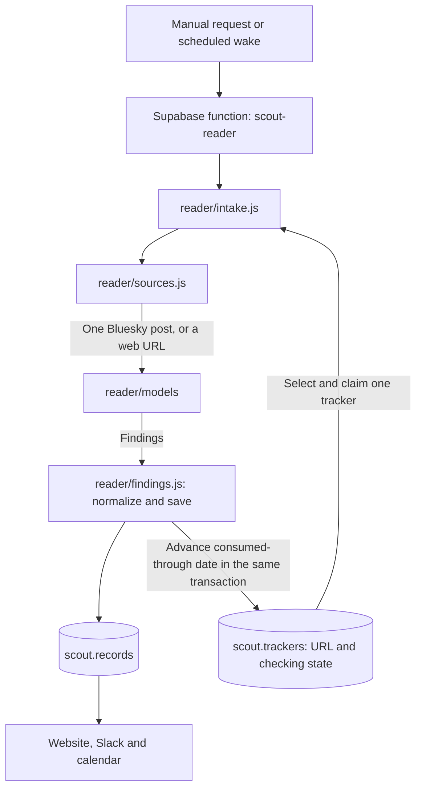

# Scout architecture

The flat record schema and its reader, website, notification and calendar consumers were deployed on 21 October 2026. Notification delivery state was removed on 2 November 2026. Recurring collection and notifications remain paused.

## Tracker investigation

[The Supabase function](../supabase/functions/scout-reader/index.ts) authenticates a backend secret, opens one database connection and calls [intake.js](../reader/intake.js). It accepts a POST without parameters for the next due tracker, or `tracker_id` for an explicit check/retry. `reader/` runs inside this function; it is not a separate hosted service.

Intake selects and claims a tracker atomically before source/model HTTP. A 120-second lease excludes overlapping checks. Ordinary web trackers supply their URL, current date and [instructions/schema](../reader/instructions.js) to the model. The model can follow relevant links during its investigation. Missing dates do not prevent saving useful findings.

For Bluesky author API and profile URLs, [sources.js](../reader/sources.js) follows API cursors from newest posts back to `last_successful_check`. It keeps the window in memory and supplies each post, including native image, quote and reply context, to the same model workflow, oldest first. Original posts use the earlier of their creation/indexing dates; reposts use the repost date. Pinned entries are excluded. Search feeds are not included in this extension.

Each successful post saves findings with its individual post URL and advances the cutoff in the same transaction. A valid empty result also advances. Posts sharing a timestamp commit together after every post in that group succeeds. Invalid output, ambiguous matching or a failed save leaves that group unconsumed. The lease and unchanged tracker URL are checked before saving. After the full window, including an empty window, the cutoff advances to the check's start time. Newer posts wait for the next check. An unchanged feed makes no model calls.

A changed URL resets its cutoff to three weeks back and disables automatic checks until backend enablement. Date-only progress deliberately has no consumed-ID table or persistent API cursor: a failed timestamp group can replay, reposts and other trackers can revisit the same content, and a late/backdated insertion behind the cutoff can be missed.

## Tracker state

Source configuration and current progress live together in `scout.trackers`:

| Field | Meaning |
| --- | --- |
| `retire_on` | Optional UTC date on which the tracker stops accepting checks and disappears from the website tracker list. Null keeps an ongoing source eligible. Saved findings remain available. |
| `last_checked_at` | When the latest attempt started. A tracker is due when this is null or this date plus `cadence` has passed. |
| `last_successful_check` | Source content consumed through this date. Initially seeded three weeks back; subsequently advanced only by successful processing. |
| `last_error` | Short reason for the latest unsuccessful attempt; cleared on success. |
| `failure_count` | Attempts since successful progress, including a claimed attempt. Three consecutive attempts without progress stop automatic retries. |
| `lease_id`, `lease_until` | Temporary ownership of an in-flight check; cleared when finished. |

A terminated worker's claim remains counted unless it committed progress. An explicit tracker-ID request starts another bounded cycle after three failures, without stealing a live lease. Failures retry on the tracker cadence; there is no separately stored next-check date. `last_checked_at` does not imply successful retrieval; inspect `last_error` too. The initial `last_successful_check` is a chosen starting boundary, not evidence of an earlier model check.

Retirement applies to scheduled, explicit and local diagnostic checks without deleting tracker rows or findings. COP17-specific sources retire on 28 November 2026, four weeks after the conference closed; the general CBD side-event registry remains ongoing. The reader claim and scheduler use the UTC date, and the website excludes retired rows in its existing tracker query. No retirement job or history is stored.

There is no stored status enum, permanent completion flag, seed-import key or separate source-state table. The legacy `collector` configuration column remains; the reader does not inspect it. The dashboard queries tracker rows directly, with no finding-job backlog view. Browser users cannot write operational state or read lease tokens.

## Findings and model calls

[findings.js](../reader/findings.js) validates and saves the model's eight fields directly, under the existing transaction advisory lock. Every record has exactly these columns:

| Field | Stored value |
| --- | --- |
| `id` | UUID |
| `description` | Nonempty text |
| `type` | event, announcement, treaty_status, or null |
| `priority` | high, normal, low, or null |
| `organizations` | Array of organization name strings |
| `deadline`, `date` | A YYYY-MM-DD, YYYY-MM or YYYY string, or null |
| `starttime`, `timezone` | Scalar strings or null |
| `sources` | Array of URLs supplied to the model |
| `modified` | Array of UTC timestamps: creation, then saved changes |

Dates stay as text to preserve partial dates. Calendar bounds and UTC instants are computed when needed; they are not stored fields. No title, kind, details, date_span, completeness, relevance, versions, identity aliases, overrides or provenance remain on records.

Identical findings make no record writes. Each saved change, including an additional source URL, appends one timestamp to `modified`. Missing optional values do not erase established facts. The migration preserves the known creation and latest-change timestamps; it does not reconstruct missing historical updates. Legacy source and canonical URLs, including registration links, are flattened and deduplicated.

Identity-key matching is removed. Existing description/source candidate lookup, exact descriptions, word overlap and sole same-type source selection remain pending a separate matching decision; no new matching system is introduced. The existing heuristic can still produce duplicates or associate findings incorrectly. All returned findings, descriptions and organizations are handled without content-count or text-length truncation.

The findings RPC returns only these 11 columns. It accepts `p_type`; organization filtering uses name arrays, and date filtering selects `date` or `deadline`. RLS and server-side Workspace access checks remain.

[The model gateway](../reader/models/gateway.js) makes one Gemini attempt per source item and, for eligible failures, one OpenAI fallback. Gemini uses URL Context; OpenAI uses provider web access. Supplied posts do not require browsing metadata; browsing remains available for missing details and images. URL-only investigations still require retrieval evidence. The existing timeouts remain (45 seconds per Gemini attempt, 100 seconds shared by source retrieval and all model calls in the check). Earlier committed dates survive a later timeout. Explicit diagnostic provider selection disables fallback. There is no generic admission dispatcher or database prerequisite for a model call.

The providers enforce their actual context, output and account limits. Scout does not set request/response byte, output-token, URL, tool-call or finding-count caps. Provider truncation and malformed output fail visibly. There is no model usage ledger, uncertain-charge estimate, application spending limit, reservation/settlement call or quota cleanup. Scheduling is controlled by the cron job itself, which remains disabled.

[database.js](../reader/database.js) wraps the Postgres connection with parameterized queries and transactions. It returns invocation-local SQL statement, mutation and byte measurements without gating work or retaining query parameters or result bodies. It is an internal SQL wrapper, not another network API.

## Other components

- [website/](../website/) displays findings and tracker state. Firebase hosts the static interface; Supabase Auth and RLS protect data. Verified Ocean Agentics Google identities retain reader access and backend-granted admin roles.
- [scout-notify](../supabase/functions/scout-notify/index.ts) calls the existing [Slack workflow](../slackbot/slack.js) for explicitly requested sends. Findings use the existing high-priority, creation-time and event-date eligibility rules. Preview expiration and modification checks remain. Each request can send the same eligible finding again, including after a successful or uncertain send; concurrent requests can also repeat a send. Delivery outcomes are returned only to the caller. There is no persistent delivery state, reservation or suppression of repeat sends. No notifications are sent during reader checks.
- [scout-calendar](../supabase/functions/scout-calendar/index.ts) serves the private subscription feed. Direct writes to personal Google calendars were removed on 2 November 2026. It reads the flat saved findings. Exact-day events become labelled date entries, with their supported start time and timezone in the description. No event duration is invented; partial/unknown dates are excluded. Record IDs continue to identify existing subscription entries.
- [diagnostics/run-reader.js](../diagnostics/run-reader.js) launches a hosted check. Its explicit diagnostic mode reads the tracker once and runs the local reader with in-memory findings, with no shared database writes; see [diagnostics instructions](../diagnostics/README.md).
- The retired `collector/` pipeline and static tracker seed file were removed on 2 November 2026. Trackers are managed through the website. Their UUIDs identify existing rows; no replacement import bookkeeping is stored. The old `scout-collect-hsa` endpoint retains its HTTP 410 retirement response.

Production stores findings, source URLs and compact current state. Source bodies, prompts, responses and proof trails are not production records. The requested local traffic capture remains confined to diagnostics.

## Cutover

The [Bluesky feed migration](../supabase/migrations/20261102200000_scout_feed_reader.sql) replaces `next_check_at` with `last_successful_check`, initialized three weeks before migration time. It requires paused jobs and no active tracker lease. Deploy the reader and website and reinstall [the paused scheduler](../supabase/scout-loop.sql) with this schema change. No finding rows are migrated. Each completed timestamp group adds one tracker update; model calls scale with new posts, not old feed content. An empty window uses five SQL statements and two tracker row mutations, with zero model calls. Source bodies and API cursors are discarded at the end of the invocation.

The flat-record migration converts existing findings in one transaction, preserving IDs, supported scalar values, source URLs, known timestamps, access controls and notification delivery outcomes. It removes obsolete record columns and their dependent indexes, the derived reader view and the old JSON date functions. The existing findings RPC is replaced with a direct projection of the flat table.

The migration requires paused jobs, no active tracker lease and no sending notification. Deploy the reader, notification and calendar functions and the website with the schema change during a short maintenance window.

Keep all four Scout cron jobs paused. Migration verification covers conversion, unchanged saves, updates, access boundaries and all active consumers. This migration does not add cost measurement or model accounting. No Slack messages or Google Calendar synchronization are part of verification.

Production conversion preserved all 111 existing records, 44 trackers and 12 delivery outcomes. All 77 tests passed. The explicit pavilion tracker check subsequently created 99 records and changed none, bringing the total to 210; it exercised live model-to-database persistence, but the source blocked independent direct retrieval, so this does not establish the correctness of every returned finding. The deployed findings RPC returns exactly the 11 fields, and the private calendar feed still works.

The [2 November delivery-state removal](../supabase/migrations/20261102180000_scout_remove_delivery_state.sql) drops `scout.delivery_state` and its existing rows. Deploy `scout-notify` first, with all Scout jobs paused and no active notification request, then apply the migration. No other consumer needs redeployment. Explicit single-finding sends now use two read queries and zero row mutations, with no model call or retained delivery bytes. Local hosted-function tests use real in-memory SQL and a mocked Slack response; verification must not send Slack messages or synchronize Google Calendar.
