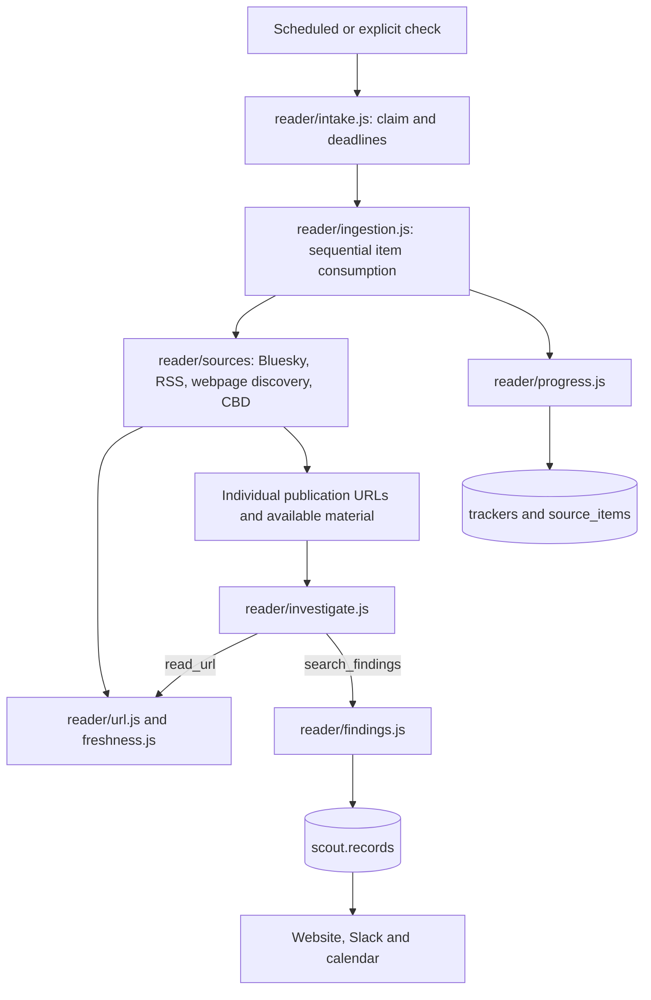

# Scout architecture

Scout saves BBNJ events, announcements and treaty developments in flat findings shared by the website, Slack and calendar. Collection wakes every six minutes and checks one due tracker. The company timezone is America/New_York; stored instants remain UTC and published dates retain their precision. Deployment instructions are in [README](../README.md#supabase-deployment).

## Shared item ingestion

The authenticated [hosted reader](../supabase/functions/scout-reader/index.ts) reserves one database connection and calls intake. Intake atomically claims a tracker with a 120-second lease, then invokes the shared ingestion service. Source/model work happens outside database transactions. An explicit tracker ID can retry a source that stopped after three unsuccessful attempts, without stealing a live lease.

[Source adapters](../reader/sources/index.js) enumerate publications; they do not decide relevance or match findings. Bluesky retains native author-feed pagination and consumed-through timestamp groups. RSS/Atom uses a pinned XML parser, publisher GUID/ID or observed permalink, and a digest of stable entry fields. Webpage discovery uses a separate model schema to identify observed entry URLs and available summaries. Within the same bounded model attempt it can read linked publication collections and return their individual article/PDF URLs; returned URLs must be observed in the supplied page or a page read during discovery. Invalid links are excluded and counted; valid items can save while a partial discovery remains unacknowledged. Pages without separate entries and native PDF/image resources can be singleton items. CBD uses its existing public article API mapping while retaining the public page URL.

An item carries key, public url, optional published_at/version, source_kind and invocation-local prepared content. Native posts require published_at for their original publication time; their separate at field tracks feed activity, including reposts. Original publication timestamps are not persisted; activity timestamps supply the existing tracker checkpoint. Its public URL is trusted caller context: it is never taken from the model's returned finding fields. A feed endpoint, CBD API endpoint or tracker homepage cannot silently replace that URL. A homepage is a finding URL only when the homepage itself is the investigated item.

The [ingestion service](../reader/ingestion.js) applies native post age eligibility immediately after discovery, before registration or investigation. Intake supplies oldest_date, one calendar month before the check's New York date. Original publication days before that cutoff are excluded without model calls or per-post SQL writes. Web/RSS publication dates are publisher hints and cannot discard new or changed items by themselves; unchanged versions and resource freshness retain their existing skips. Investigation still filters confirmed-old findings by their finding dates before saving.

The ingestion service durably registers discovered non-native item keys, URLs and versions before investigation. Items run sequentially through one investigation and commit independently. The finding writes and consumed progress share one short transaction with lease/URL validation. Irrelevant and explicit identity-skip outcomes still consume the item; model/save failures leave it pending. Earlier committed items survive a later timeout. Pending items resume before rediscovery, using their saved URLs; no source body or model conversation is stored.

Bluesky starts with a null checkpoint and reads eligible posts oldest first across bounded attempts, excluding pinned posts and deferring posts newer than the invocation start. Each investigation receives the current post, its own attachments and optional repost metadata, excluding the feed's embedded parent/root bodies so their announcements cannot be attributed to a later reply. The current post's reply references remain available for contextual reads. Pagination stops when feed activity crosses the age boundary or committed checkpoint. A recent repost of an expired original does not stop pagination; shared ingestion excludes it using the original publication time. Posts sharing an activity timestamp commit atomically. Later posts in that group see earlier proposed findings in memory, including proposed IDs and source URLs. A failed group remains unconsumed. After a complete scan, including one with no eligible posts, its native checkpoint advances to the check start. The age cutoff is never seeded as progress. Unchanged feeds make no model calls. Date-only native progress can miss late/backdated posts behind its cutoff; it does not introduce a second receipt table for already consumed history.

## HTTP and freshness

[reader/url.js](../reader/url.js) owns public-address checks, redirect validation, a 15-second HTTP bound and invocation-local response caching. HTML preparation retains ordered text, tables, absolute links, images and published structured data. JSON remains structured; XML is available to the RSS adapter. Native PDF/image checks cancel response bodies and provide URL descriptors to the model adapters.

The unchanged checker remains [reader/freshness.js](../reader/freshness.js). It sends If-Modified-Since after a successfully processed read and accepts 304 or an older/equal Last-Modified on a successful 200. When HTTP cannot establish freshness, the URL reader prepares the body and the checker compares its SHA-256 fingerprint, including the media type. HTML hashes cover the readable text, links, images and structured data supplied to the model; JSON/XML/text use their prepared content. Native PDF/image descriptors remain HTTP-only because their bytes are not read here. There is no additional HEAD request or stored ETag.

The index is checked before discovery. Each candidate article is checked before starting its model investigation; a confirmed unchanged article consumes pending progress without a model call. Pending work remains resumable even if the index is unchanged. Invocation-local caching retains prepared bodies, so each caller compares against its own committed fingerprint; a conditional response without a body cannot establish freshness for another caller.

Freshness metadata belongs to the exact fetched resource, including query parameters and redirect destinations. A listing checkpoint, feed entry consumption time or different API endpoint never establishes article freshness. Store the conservative request-start timestamp and candidate fingerprint only with successful discovery or item processing. Keep only the latest successfully processed fingerprint, overwriting it in the existing progress transaction; there is no history or stored body. Failed investigations/saves and incomplete discovery cannot acknowledge their reads. HTTP-confirmed unchanged reads preserve the prior hash. Supporting URLs have no inherited checkpoint. New source adapters use this same gate rather than adding their own checker. Changes only in linked resources remain undetected when their parent is confirmed unchanged.

## Compact progress state

scout.trackers retains name/URL/configuration, retire_on, last_checked_at, last_successful_check, last_error, failure_count, lease_id and lease_until. Its discovery_request_url, discovery_checked_at and discovery_fingerprint acknowledge listing discovery before pending articles finish. last_successful_check is the native Bluesky watermark or the latest fully completed source check, not an arbitrary article timestamp.

The backend-only scout.source_items table contains tracker_id + item_key as its primary key, url, observed_version, consumed_version, pending, consumed_at, request_url, request_checked_at and request_fingerprint. It stores current receipts and pending addresses, never summaries, documents, prompts, responses or candidate snapshots. Completed items absent from a successful fresh listing are pruned; pending items are retained. RSS unchanged versions do not repeat investigation; webpage entries with no reliable revision use article freshness. This is one compact current-state table, not a queue/history service or a new scheduled job.

New trackers have no checkpoint. Changing a URL clears its source state and disables automatic checking until backend enablement, while preserving findings. Retirement applies to scheduled, explicit and diagnostic checks. Three attempts without progress stop automatic retries; successful item commits reset the failure streak. Cadence uses completed New York days, with pending/incomplete work eligible on subsequent six-minute wakes. Browser users cannot write operational fields, read leases or access source_items.

## Investigation, duplicate search and saving

[reader/investigate.js](../reader/investigate.js) supplies one item, the common finding instructions, dates and two tools: read_url and search_findings. The model assesses relevance, reads further as needed and searches saved records before creating or updating. Searches combine ORed text phrases (each phrase matches all its words) and exact source URLs. They cover descriptions, organizations and details without restrictive type/date filters or result-count caps, and return full candidates with exact PostgreSQL revision strings.

The model includes a responsible organization name alone alongside specific topic queries and broadens unsuccessful searches. The backend rejects a create based solely on empty narrow queries when an organization is known. Matching is a model decision after retrieval; there is no separate matcher model call or description/80-percent-word/sole-source heuristic fallback.

The result has complete/unreadable status and explicit create, update, no_change or skip decisions. Updates/no_change require a searched candidate ID and exact revision. No_change requires that the saved record already contains this item's finding URL; otherwise the URL must be added by an update. The backend builds sources from the trusted item URL plus actually read supporting URLs. Ambiguous identity is an explicit reasoned skip. Conflicting established dates/deadlines skip that finding; unrelated findings and item progress can still commit.

[reader/findings.js](../reader/findings.js) normalizes supported fields and applies explicit decisions under the existing transaction advisory lock. It repeats actual candidate searches immediately before writing and rejects a changed search set or revision, including a competing create. Identical merged findings make no record writes. New facts preserve compatible precise dates, clocks, ends, optional fields, saved details and source URLs. A saved change appends one modified timestamp. The only in-group create coalescing is exact normalized field equality; it retains every item's source URL.

## Finding fields and URLs

| Column | Value |
| --- | --- |
| id | UUID |
| description | Short organization-led label |
| details | Nullable scalar text, at most 4,096 UTF-8 bytes; incremental facts, no model traffic or proof trail |
| type | event, announcement, treaty_status, or null |
| priority | high, normal, low, or null |
| organizations | Organization name strings |
| deadline, date, enddate | YYYY-MM-DD, YYYY-MM, YYYY, or null |
| starttime, endtime, timezone | Published scalar strings or null |
| sources | JSON array of objects with url and role: finding, supporting or unclassified |
| modified | Creation and saved-change UTC timestamps |

The one-time source conversion preserves every old URL as unclassified, along with IDs and timestamps; it does not fabricate a primary link. Merge sources by normalized URL, applying the incoming explicit role so a read supporting page can correct an earlier finding label. The current item URL always remains a finding source. Several publications can support one finding and an article can produce several findings. Slack Read more chooses the first evidenced finding URL; legacy records without one retain their description/tag and omit Read more. The website labels source roles and exposes details; calendar descriptions retain all URLs.

The existing one-calendar-month capture cutoff applies to normalized facts of every type. Unknown/future dates remain eligible; partial dates are excluded only if their latest possible day is before the cutoff. Malformed optional dates, ends or details are dropped with numeric field counts without losing useful fields. Compatible precise saved facts are retained. Existing findings are not deleted by this capture rule. The findings RPC includes details in text search and retains its workspace access, filters and pagination.

## Models, deadlines and cost

[reader/models](../reader/models/) owns provider protocol, JSON schema, tool continuations and finite fallback. Workflow-specific schemas/validation live with discovery and investigation. OpenAI handles web items; Bluesky uses Gemini with at most one OpenAI fallback for eligible failures. Explicit diagnostic provider selection disables fallback. Gemini and OpenAI support custom read/search continuations while preserving their native call IDs/signatures. OpenAI uses store:false. Failed native file inputs get the existing single recovery continuation and are not resubmitted.

Initial retrieval and every model continuation share a 100-second invocation deadline; Gemini is additionally bounded to 45 seconds. Commit transactions have an invocation-relative 110-second cutoff, statements clipped to remaining time, and post-commit callbacks a 115-second cutoff. The lease and scheduled caller remain 120 seconds, and the manual caller 125. A timeout returns partial committed counts and pending state. Notifications/calendar callbacks do not replay ingestion; daily calendar reconciliation repairs interrupted publication.

Numeric invocation diagnostics measure provider requests/tokens, HTTP requests/bytes, SQL statements/mutations/bytes and elapsed work. No content, parameters, model usage ledger, uncertain-charge reservation or operation report is persisted. The service adds no jobs, artificial finding/tool/text caps or paid infrastructure. Cost scales with changed discovery pages, pending/changed articles, tool continuations, candidate searches and actual record changes. Existing account allowances and provider limits apply; estimates and acceptance cases are described in the [shared ingestion design](shared-ingestion-architecture.md).

## Other components

- [website/](../website/) displays findings and tracker state. Firebase hosts the static interface; Supabase Auth and RLS protect data. Verified Ocean Agentics Google identities retain reader access and backend-granted admin roles.
- [scout-notify](../supabase/functions/scout-notify/index.ts) sends scheduled morning and weekly findings through the [Slack workflow](../slackbot/slack.js). Morning runs at 8 a.m. daily and includes high-priority same-day events; known instants are compared in New York time, otherwise the published exact date is used. Weekly runs Mondays at 9 a.m. and includes pending high-priority events, including undated events, and high-priority announcements created in the preceding seven local days. The hosted reader posts newly created high-priority records after committed collection work; updates and unchanged findings do not trigger posts. All Slack paths require `priority='high'`. Each finding gets its own message containing the saved description, bracketed priority/type initials (for example, `[ha]` for high-priority announcement) and source link, with no model calls. Messages send sequentially, spaced at least one second apart. A nonempty notification uses two read queries and makes no delivery-state writes. Preview expiration and modification checks remain; sending stops on a failed or uncertain send and reports the confirmed send count. Delivery outcomes return only to the caller; delivery is best effort, with no persistent send suppression or automatic retry after uncertain sends. Explicit repeated requests can repeat a post. Collection wakes every six minutes; scheduled digests and calendar reconciliation use two GMT candidate hours with a New York hour guard for daylight saving. Installation leaves all jobs paused for verification.
- Slack delivery has one owner: `botTransport` in [slackbot/slack.js](../slackbot/slack.js), used by the reader and notifier with `SCOUT_SLACK_BOT_TOKEN` and `chat.postMessage`. Each payload carries its record ID in message metadata. Maintenance and future agent replies use the same bot identity, which can edit/delete its own messages. Incoming webhooks are disabled and their historical authorizations are removed; there is no webhook transport or fallback. Historical webhook posts remain separately owned and require thread corrections or an authorized owner deletion. [scout-slack](../supabase/functions/scout-slack/index.ts) verifies signed inbound requests with `SLACK_SIGNING_SECRET`, answers URL challenges and acknowledges events without retaining their bodies or invoking models/database work. Conversational answers are deferred. The [exported manifest](../slackbot/manifest.json) records app `A0C5P53NAPM`, with channel/DM communication scopes, unmentioned reply events and a verified HTTP receiver instead of Socket Mode. See [Slack credentials and maintenance](../README.md#slack-credentials) for the stable identities, API operations and release verification.
- [scout-calendar](../supabase/functions/scout-calendar/index.ts) serves the private subscription feed. Verified Ocean Agentics users retrieve its link through the Scout Calendar button. It reads the flat saved findings. High-priority titles begin with `⭐`; other priorities are unmarked. Low-priority titles omit the penguin icon. Exact-day events with supported clocks become timed ranges, converted to UTC when both clocks resolve uniquely; unresolved clocks remain local floating times. Events without a start clock and multi-day spans without complete clock bounds become all-day ranges, converting the inclusive final day to an exclusive calendar end date. Published bounds and source timezones remain in the description. Missing ends never acquire an invented duration in the feed; partial/unknown start dates are excluded. Record IDs continue to identify existing subscription entries; subscription revisions also advance when end fields become visible.
- [diagnostics/run-reader.js](../diagnostics/run-reader.js) launches a hosted check. Its explicit diagnostic mode reads the tracker once and runs the local reader with in-memory findings, with no shared database writes; see [diagnostics instructions](../diagnostics/README.md).
- The retired `collector/` pipeline and static tracker seed file were removed on 2 November 2026. Trackers are managed through the website. Their UUIDs identify existing rows; no replacement import bookkeeping is stored. The old `scout-collect-hsa` endpoint retains its HTTP 410 retirement response.

Production stores findings, source URLs and compact current state. Source bodies, prompts, responses and proof trails are not production records. The requested local traffic capture remains confined to diagnostics.

Google publishing uses [google.js](../calendar/google.js) and the existing OAuth refresh credential in encrypted Vault. After each reader save commits, created or changed event IDs are published independently of Slack delivery. Failures return to the caller without replaying collection. The backend-only `scout-calendar/reconcile` route compares saved events with Scout-tagged entries in the fixed shared Scout Google calendar; the daily `scout-calendar` job runs it at 4 a.m. New York time. Stable IDs prevent duplicate entries; unchanged entries make no Google writes, and cleanup removes only Scout-tagged entries no longer eligible. ETags reject writes against a changed Google revision. Each run is bounded, with daily reconciliation repairing interrupted immediate updates. No model calls, tables, queues or per-event database sync state are added.

Google entries share the subscription feed's eligibility, titles, descriptions and multi-day date ranges. Supported UTC ends replace placeholder ends. Resolved starts with unknown clock ends retain a 30-minute placeholder explicitly labeled “End time unknown”; it is never saved as a Scout end. Dates without a resolved instant become all-day entries with published clocks retained in the description. Partial/unknown start dates are excluded. Scout's table and cards also show supported end fields.
