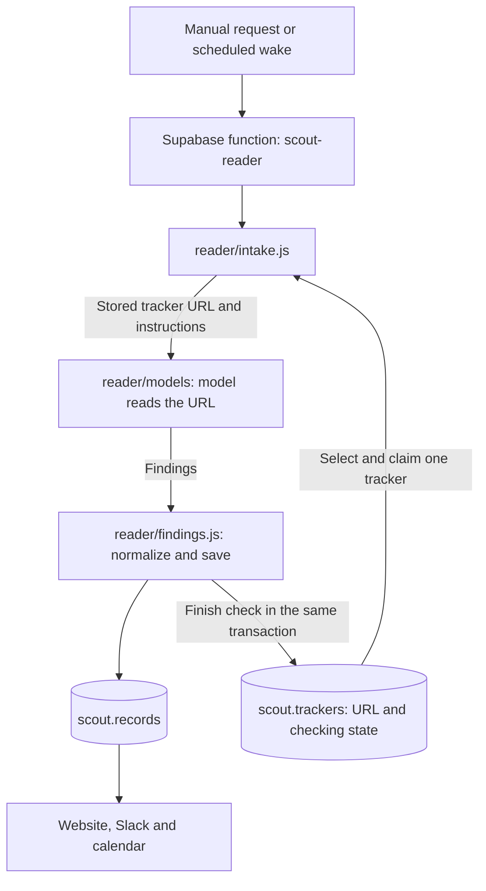

# Scout architecture

The flat record schema and its reader, website, notification and calendar consumers were deployed on 21 October 2026. Recurring collection and notifications remain paused.

## Tracker investigation

[The Supabase function](../supabase/functions/scout-reader/index.ts) authenticates a backend secret, opens one database connection and calls [intake.js](../reader/intake.js). It accepts a POST without parameters for the next due tracker, or `tracker_id` for an explicit check/retry. The URL is read from that tracker, unchanged. `reader/` runs inside this function; it is not a separate hosted service.

Intake selects and claims a tracker atomically before model HTTP. A 120-second lease excludes overlapping checks. It supplies the URL, current date and [instructions/schema](../reader/instructions.js) to the model. There is no publisher dispatch, page preparation, article inventory, fingerprint check or separate scheduling-research pass. The model can follow relevant links during its investigation. Missing dates do not prevent saving useful findings.

The response is normalized and saved in a transaction that also finishes the tracker check. The lease and unchanged tracker URL are checked before saving. A changed URL resets its state and disables automatic checks until backend enablement. Failed saves roll back the finding and successful completion together.

## Tracker state

Source configuration and current progress live together in `scout.trackers`:

| Field | Meaning |
| --- | --- |
| `next_check_at` | When an enabled tracker becomes eligible again. Success schedules from its cadence. |
| `last_checked_at` | When the last attempt finished, including failure. |
| `last_error` | Short reason for the latest unsuccessful attempt; cleared on success. |
| `failure_count` | Attempts since success, including the current claimed attempt. Three stop automatic retries. |
| `lease_id`, `lease_until` | Temporary ownership of an in-flight check; cleared when finished. |

A terminated worker's attempt remains counted. An explicit tracker-ID request starts another bounded cycle after three failures, without stealing a live lease. `last_checked_at` does not imply successful retrieval; inspect `last_error` too.

There is no stored status enum, permanent completion flag or separate source-state table. The legacy `collector` configuration column remains for the retained scraper files; the reader does not inspect it. The dashboard queries tracker rows directly, with no finding-job backlog view. Browser users cannot write operational state or read lease tokens.

## Findings and model calls

[findings.js](../reader/findings.js) validates and saves the model's eight fields directly, under the existing transaction advisory lock. Every record has exactly these columns:

| Field | Stored value |
| --- | --- |
| `id` | UUID |
| `description` | Nonempty text |
| `type` | event, announcement, treaty_status, or null |
| `priority` | high, normal, low, or null |
| `organizations` | Array of organization name strings |
| `deadline`, `date` | A YYYY-MM-DD, YYYY-MM or YYYY string, or null |
| `starttime`, `timezone` | Scalar strings or null |
| `sources` | Array of URLs supplied to the model |
| `modified` | Array of UTC timestamps: creation, then saved changes |

Dates stay as text to preserve partial dates. Calendar bounds and UTC instants are computed when needed; they are not stored fields. No title, kind, details, date_span, completeness, relevance, versions, identity aliases, overrides or provenance remain on records.

Identical findings make no record writes. Each saved change, including an additional source URL, appends one timestamp to `modified`. Missing optional values do not erase established facts. The migration preserves the known creation and latest-change timestamps; it does not reconstruct missing historical updates. Legacy source and canonical URLs, including registration links, are flattened and deduplicated.

Identity-key matching is removed. Existing description/source candidate lookup, exact descriptions, word overlap and sole same-type source selection remain pending a separate matching decision; no new matching system is introduced. The existing heuristic can still produce duplicates or associate findings incorrectly. All returned findings, descriptions and organizations are handled without content-count or text-length truncation.

The findings RPC returns only these 11 columns. It accepts `p_type`; organization filtering uses name arrays, and date filtering selects `date` or `deadline`. RLS and server-side Workspace access checks remain.

[The model gateway](../reader/models/gateway.js) makes one Gemini attempt and, for eligible failures, one OpenAI fallback. Gemini uses URL Context; OpenAI uses provider web access. The existing request timeouts remain (45 seconds for Gemini, 100 seconds total); provider errors defer the tracker until its retry time. Explicit diagnostic provider selection disables fallback. There is no generic admission dispatcher or database prerequisite for a model call.

The providers enforce their actual context, output and account limits. Scout does not set request/response byte, output-token, URL, tool-call or finding-count caps. Provider truncation and malformed output fail visibly. There is no model usage ledger, uncertain-charge estimate, application spending limit, reservation/settlement call or quota cleanup. Scheduling is controlled by the cron job itself, which remains disabled.

[database.js](../reader/database.js) wraps the Postgres connection with parameterized queries and transactions. It returns invocation-local SQL statement, mutation and byte measurements without gating work or retaining query parameters or result bodies. It is an internal SQL wrapper, not another network API.

## Other components

- [website/](../website/) displays findings and tracker state. Firebase hosts the static interface; Supabase Auth and RLS protect data. Verified Ocean Agentics Google identities retain reader access and backend-granted admin roles.
- [scout-notify](../supabase/functions/scout-notify/index.ts) calls the existing [Slack workflow](../slackbot/slack.js) for explicitly requested sends. Existing delivery outcomes and uncertain-send protection remain in `delivery_state`; a delivered modification timestamp replaces the former record-version dependency. No notifications are sent during reader checks.
- [scout-calendar](../supabase/functions/scout-calendar/index.ts) retains the existing private subscription feed and explicit Google Calendar synchronization. It reads the flat saved findings. Exact-day events become labelled date entries, with their supported start time and timezone in the description. No event duration is invented; partial/unknown dates are excluded. Record IDs continue to identify existing calendar entries.
- [diagnostics/run-reader.js](../diagnostics/run-reader.js) launches a hosted check. Its explicit diagnostic mode reads the tracker once and runs the local reader with in-memory findings, with no shared database writes; see [diagnostics instructions](../diagnostics/README.md).
- [collector/](../collector/), including `discovery/`, is retained for later review/removal. Nothing in the new hosted reader imports it. Legacy database integration tests use the pre-reader schema. The old deployed endpoint returns HTTP 410.

Production stores findings, source URLs and compact current state. Source bodies, prompts, responses and proof trails are not production records. The requested local traffic capture remains confined to diagnostics.

## Cutover

The flat-record migration converts existing findings in one transaction, preserving IDs, supported scalar values, source URLs, known timestamps, access controls and notification delivery outcomes. It removes obsolete record columns and their dependent indexes, the derived reader view and the old JSON date functions. The existing findings RPC is replaced with a direct projection of the flat table.

The migration requires paused jobs, no active tracker lease and no sending notification. Deploy the reader, notification and calendar functions and the website with the schema change during a short maintenance window. Legacy collector files and their historical-schema tests remain outside the active runtime and must not run against the new schema.

Keep all four Scout cron jobs paused. Migration verification covers conversion, unchanged saves, updates, access boundaries and all active consumers. This migration does not add cost measurement or model accounting. No Slack messages or Google Calendar synchronization are part of verification.

Production conversion preserved all 111 existing records, 44 trackers and 12 delivery outcomes. All 77 tests passed. The explicit pavilion tracker check subsequently created 99 records and changed none, bringing the total to 210; it exercised live model-to-database persistence, but the source blocked independent direct retrieval, so this does not establish the correctness of every returned finding. The deployed findings RPC returns exactly the 11 fields, and the private calendar feed still works.
