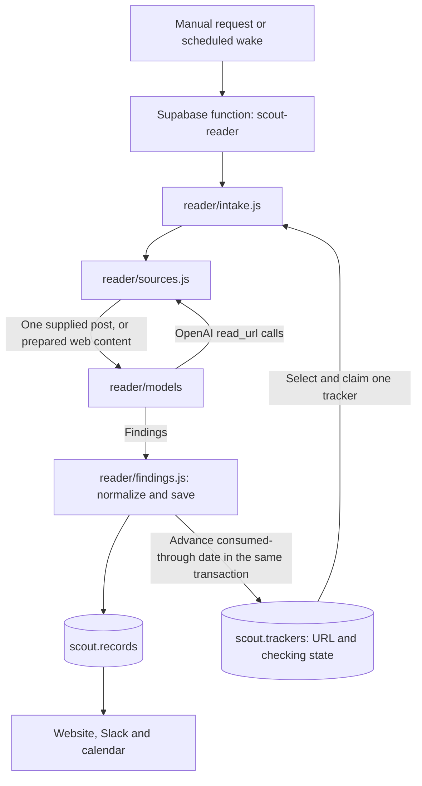

# Scout architecture

Scout uses flat saved findings shared by the reader, website, notifications and calendar. The company timezone is `America/New_York`; stored instants remain UTC, and source dates and timezones remain as published. Collection wakes every six minutes and checks one due tracker; newly saved findings post to Slack, with morning and weekly digests scheduled in New York time. For credentials, deployment commands and live verification, follow [README → Supabase deployment](../README.md#supabase-deployment). Completed cutover instructions and run results remain in Git history.

## Tracker investigation

[The Supabase function](../supabase/functions/scout-reader/index.ts) authenticates a backend secret, opens one database connection and calls [intake.js](../reader/intake.js). It accepts a POST without parameters for the next due tracker, or `tracker_id` for an explicit check/retry. `reader/` runs inside this function; it is not a separate hosted service.

Intake selects and claims a tracker atomically before source/model HTTP. A 120-second lease excludes overlapping checks. Ordinary web trackers supply their URL, prepared content, explicit `web` source kind, current date and [instructions/schema](../reader/instructions.js) to OpenAI. [sources.js](../reader/sources.js) parses HTML into readable text while retaining schedule rows, absolute links, image references and published structured data; content-bearing JSON remains structured. CBD parallel-meeting pages use their public article API with the requested page's tags, including its accordion articles. Source HTTP checks resolved public destinations and redirect targets, uses a 15-second per-read bound within intake's deadline, and caches pending/completed reads in memory for that check. An initial HTTP failure is supplied as an explicit read error so the model can use its web tools; it is not an empty source.

The OpenAI adapter exposes `read_url` for relevant detail pages, programmes, PDFs and images. Independent calls return in one continuation. PDF/image HTTP checks cancel their bodies, and the adapter supplies native file/image URL inputs to OpenAI. A document-specific native-input rejection replaces that batch with read errors and permits one recovery continuation using the other evidence; failed native files are not resubmitted. Source bodies and stateless model history remain invocation-local, with `store:false` throughout. Missing dates, broken linked documents and incomplete directory coverage do not prevent saving useful findings. Collection adds no coverage gate, cleanup queue or repair job.

Bluesky collection resumes from successfully committed progress so consumed posts are not investigated again. For author API and profile URLs, [sources.js](../reader/sources.js) follows API cursors from newest posts back to `last_successful_check`. A null checkpoint means no prior check: follow cursors to the end of the available history, without a date boundary. It keeps the unconsumed window in memory and supplies each post, including native image, quote and reply context, to the same model workflow, oldest first. Initial history can require multiple bounded attempts. Original posts use the earlier of their creation/indexing dates; reposts use the repost date. Pinned entries are excluded. Search feeds are not included in this extension.

Each successful post saves findings with its individual post URL and advances the cutoff in the same transaction. A valid empty result also advances. Posts sharing a timestamp commit together after every post in that group succeeds. Unusable model output or a failed save leaves that group unconsumed. Ambiguous/conflicting findings are skipped individually while other findings and progress commit. The lease and unchanged tracker URL are checked before saving. After the full window, including an empty window, the cutoff advances to the check's start time. Newer posts wait for the next check. An unchanged feed makes no model calls. Successful progress acknowledges collection's attempt, not complete source coverage; later cleanup is separate work.

A new tracker has no checkpoint; a changed URL clears its checkpoint and disables automatic checks until backend enablement. Never seed a successful-check timestamp or substitute a rolling look-back window. Preserve existing committed checkpoints. The source API can return already consumed posts while finding the boundary; those posts do not reach the model. Date-only progress deliberately has no consumed-ID table or persistent API cursor: a failed timestamp group can replay, reposts and other trackers can revisit the same content, and a late/backdated insertion behind the cutoff can be missed.

## Tracker state

Source configuration and current progress live together in `scout.trackers`:

| Field | Meaning |
| --- | --- |
| `retire_on` | Optional New York date on which the tracker stops accepting checks and disappears from the website tracker list. Null keeps an ongoing source eligible. Saved findings remain available. |
| `last_checked_at` | When the latest attempt started. A check is fully complete when this equals `last_successful_check`. Incomplete attempts remain eligible for retry. After completion, `cadence` runs from midnight of that New York calendar day. Current trackers use one day. |
| `last_successful_check` | Null until the source commits progress. For Bluesky, posts consumed through this date; for web pages, the latest completed page investigation. Advanced with successful processing, never an invented starting boundary. |
| `last_error` | Short reason for the latest unsuccessful attempt; cleared on success. |
| `failure_count` | Attempts since successful progress, including a claimed attempt. Three consecutive attempts without progress stop automatic retries. |
| `lease_id`, `lease_until` | Temporary ownership of an in-flight check; cleared when finished. |

A terminated worker's claim remains counted unless it committed progress. An explicit tracker-ID request starts another bounded cycle after three failures, without stealing a live lease. Failures can retry on later six-minute wakes, with older attempts selected first; there is no separately stored next-check date. A partial Bluesky checkpoint does not equal the attempt start time and therefore cannot complete the day, even if the worker dies before storing an error. `last_checked_at` does not imply successful retrieval; inspect `last_error` too. A null checkpoint remains eligible for retry after a failed first attempt. Web completion does not filter previously read page items; the configured page is investigated again when due. An explicit tracker-ID request can recheck a source already completed today.

Retirement applies to scheduled, explicit and local diagnostic checks without deleting tracker rows or findings. COP17-specific sources retire on 28 November 2026, four weeks after the conference closed; the general CBD side-event registry remains ongoing. The reader claim and scheduler use the New York date, and the website excludes retired rows in its existing tracker query. No retirement job or history is stored.

There is no stored status enum, permanent completion flag, seed-import key or separate source-state table. The legacy `collector` configuration column remains; the reader does not inspect it. The dashboard queries tracker rows directly, with no finding-job backlog view. Browser users cannot write operational state or read lease tokens.

## Findings and model calls

[findings.js](../reader/findings.js) validates and saves the model's ten fields directly, under the existing transaction advisory lock. Every record has exactly these columns:

| Field | Stored value |
| --- | --- |
| `id` | UUID |
| `description` | Nonempty text |
| `type` | event, announcement, treaty_status, or null |
| `priority` | high, normal, low, or null |
| `organizations` | Array of organization name strings |
| `deadline`, `date`, `enddate` | A YYYY-MM-DD, YYYY-MM or YYYY string, or null |
| `starttime`, `endtime`, `timezone` | Scalar strings or null |
| `sources` | Array of supporting source URLs |
| `modified` | Array of UTC timestamps: creation, then saved changes |

Dates stay as text to preserve partial dates. `enddate` is the inclusive published final day; `endtime` uses the record's `timezone`. The extractor captures published ends and calculates an end from an explicit duration when the start is sufficiently precise. Missing, malformed or contradictory ends remain null without rejecting a useful finding or triggering extra reads, retries or model fallback. Omitted ends preserve compatible saved facts; a changed final day does not inherit an old clock, and merged ranges are revalidated. UTC instants are computed when needed; they are not stored fields. No title, kind, details, date_span, completeness, relevance, versions, identity aliases, overrides or provenance remain on records.

Identical findings make no record writes. Each saved change, including an additional source URL, appends one timestamp to `modified`. Missing optional values do not erase established facts. Compatible partial dates do not replace more precise saved dates; a less precise event date also preserves its saved clock and timezone. The migration preserves the known creation and latest-change timestamps; it does not reconstruct missing historical updates. Legacy source and canonical URLs, including registration links, are flattened and deduplicated.

Every tracker check calculates an inclusive `oldest_date` one calendar month before its New York check date in the existing claim query. The model receives that cutoff and omits confirmed-old findings; intake enforces the same rule on normalized findings before matching and saving, for every record type. The record's `date` means event start, announcement publication or treaty action. Unknown and future dates remain eligible; partial dates are excluded only when their latest possible day is before the cutoff. An all-old result completes successfully without finding writes or publication callbacks. Existing records are not deleted by this capture rule.

Identity-key matching is removed. Description/source candidate lookup reads all exact descriptions and same-type source candidates without requiring matching dates. Exact descriptions retain their IDs even when a type is corrected. Word overlap and sole same-type source selection require compatible event dates. Conflicting non-null dates/deadlines and ambiguous matches increment the existing ambiguity count and skip that finding, leaving its saved record unchanged; unrelated findings and progress still commit, including when every returned finding conflicts. Malformed optional dates, clocks and timezones become null with field counts in invocation diagnostics; they do not reject other useful fields or trigger model fallback. Gatherings remain events after their dates pass; distinct recap and recording publications are announcements. These matching heuristics can still miss differently worded findings on unrelated URLs or associate findings incorrectly. All returned findings, descriptions and organizations are handled without content-count or text-length truncation.

The findings RPC returns these 13 columns. It accepts `p_type`; organization filtering uses name arrays, and date filtering selects `date` or `deadline`. RLS and server-side Workspace access checks remain.

[The model gateway](../reader/models/gateway.js) sends web investigations directly to OpenAI. Its native inputs and custom read loop support linked investigation; the current Gemini adapter does not provide that loop and is not a web fallback. Supplied Bluesky posts retain one Gemini attempt and, for eligible failures, one OpenAI fallback. Explicit diagnostic provider selection disables fallback; requesting Gemini for a prepared web investigation fails before dispatch. Supplied readable content does not require provider browsing metadata; an investigation without readable supplied content still requires retrieval evidence. Diagnostics distinguish Scout reads, provider web references and accepted/failed native inputs rather than treating citations as proof of reading.

The existing timing values remain: 45 seconds per Gemini attempt, 100 seconds shared by initial source retrieval and every model continuation, a 120-second lease/scheduled HTTP timeout, and a 125-second manual hosted caller timeout. OpenAI uses the check's remaining time without restarting its deadline. These values are tunable if measured hosted behavior requires it; extending a lease alone does not extend the runtime or a waiting caller. Reserve time for saving, failure reporting and post-commit notifications. Earlier committed dates survive a later timeout. There is no generic admission dispatcher, model ledger or database prerequisite for a model call. Numeric model request/token totals, source body bytes and elapsed time return only in invocation diagnostics.

The providers enforce their actual context, output and account limits. Scout does not set request/response byte, output-token, URL, tool-call or finding-count caps. Provider truncation and malformed output fail visibly. There is no model usage ledger, uncertain-charge estimate, application spending limit, reservation/settlement call or quota cleanup. The six-minute cron job invokes the reader only while an eligible tracker remains. When all trackers are complete, wakes do only eligibility checks and existing cron-history housekeeping; they make no model calls or finding writes. The scheduler installation SQL leaves jobs paused so the deployed reader can be verified before collection is enabled.

[database.js](../reader/database.js) wraps the Postgres connection with parameterized queries and transactions. It returns invocation-local SQL statement, mutation and byte measurements without gating work or retaining query parameters or result bodies. It is an internal SQL wrapper, not another network API.

## Other components

- [website/](../website/) displays findings and tracker state. Firebase hosts the static interface; Supabase Auth and RLS protect data. Verified Ocean Agentics Google identities retain reader access and backend-granted admin roles.
- [scout-notify](../supabase/functions/scout-notify/index.ts) sends scheduled morning and weekly findings through the [Slack workflow](../slackbot/slack.js). Morning runs at 8 a.m. daily and includes high-priority same-day events; known instants are compared in New York time, otherwise the published exact date is used. Weekly runs Mondays at 9 a.m. and includes pending high-priority events, including undated events, and high-priority announcements created in the preceding seven local days. The hosted reader posts newly created high-priority records after each save group commits; updates and unchanged findings do not trigger posts. All Slack paths require `priority='high'`. Each finding gets its own message containing the saved description, bracketed priority/type initials (for example, `[ha]` for high-priority announcement) and source link, with no model calls. Messages send sequentially, spaced at least one second apart. A nonempty notification uses two read queries and makes no delivery-state writes. Preview expiration and modification checks remain; sending stops on a failed or uncertain send and reports the confirmed send count. Delivery outcomes return only to the caller; delivery is best effort, with no persistent send suppression or automatic retry after uncertain sends. Explicit repeated requests can repeat a post. Collection wakes every six minutes; scheduled digests and calendar reconciliation use two GMT candidate hours with a New York hour guard for daylight saving. Installation leaves all jobs paused for verification.
- [scout-calendar](../supabase/functions/scout-calendar/index.ts) serves the private subscription feed. Verified Ocean Agentics users retrieve its link through the Scout Calendar button. It reads the flat saved findings. High-priority titles begin with `⭐`; other priorities are unmarked. Low-priority titles omit the penguin icon. Exact-day events with supported clocks become timed ranges, converted to UTC when both clocks resolve uniquely; unresolved clocks remain local floating times. Events without a start clock and multi-day spans without complete clock bounds become all-day ranges, converting the inclusive final day to an exclusive calendar end date. Published bounds and source timezones remain in the description. Missing ends never acquire an invented duration in the feed; partial/unknown start dates are excluded. Record IDs continue to identify existing subscription entries; subscription revisions also advance when end fields become visible.
- [diagnostics/run-reader.js](../diagnostics/run-reader.js) launches a hosted check. Its explicit diagnostic mode reads the tracker once and runs the local reader with in-memory findings, with no shared database writes; see [diagnostics instructions](../diagnostics/README.md).
- The retired `collector/` pipeline and static tracker seed file were removed on 2 November 2026. Trackers are managed through the website. Their UUIDs identify existing rows; no replacement import bookkeeping is stored. The old `scout-collect-hsa` endpoint retains its HTTP 410 retirement response.

Production stores findings, source URLs and compact current state. Source bodies, prompts, responses and proof trails are not production records. The requested local traffic capture remains confined to diagnostics.

Google publishing uses [google.js](../calendar/google.js) and the existing OAuth refresh credential in encrypted Vault. After each reader save commits, created or changed event IDs are published independently of Slack delivery. Failures return to the caller without replaying collection. The backend-only `scout-calendar/reconcile` route compares saved events with Scout-tagged entries in the fixed shared Scout Google calendar; the daily `scout-calendar` job runs it at 4 a.m. New York time. Stable IDs prevent duplicate entries; unchanged entries make no Google writes, and cleanup removes only Scout-tagged entries no longer eligible. ETags reject writes against a changed Google revision. Each run is bounded, with daily reconciliation repairing interrupted immediate updates. No model calls, tables, queues or per-event database sync state are added.

Google entries share the subscription feed's eligibility, titles, descriptions and multi-day date ranges. Supported UTC ends replace placeholder ends. Resolved starts with unknown clock ends retain a 30-minute placeholder explicitly labeled “End time unknown”; it is never saved as a Scout end. Dates without a resolved instant become all-day entries with published clocks retained in the description. Partial/unknown start dates are excluded. Scout's table and cards also show supported end fields.
