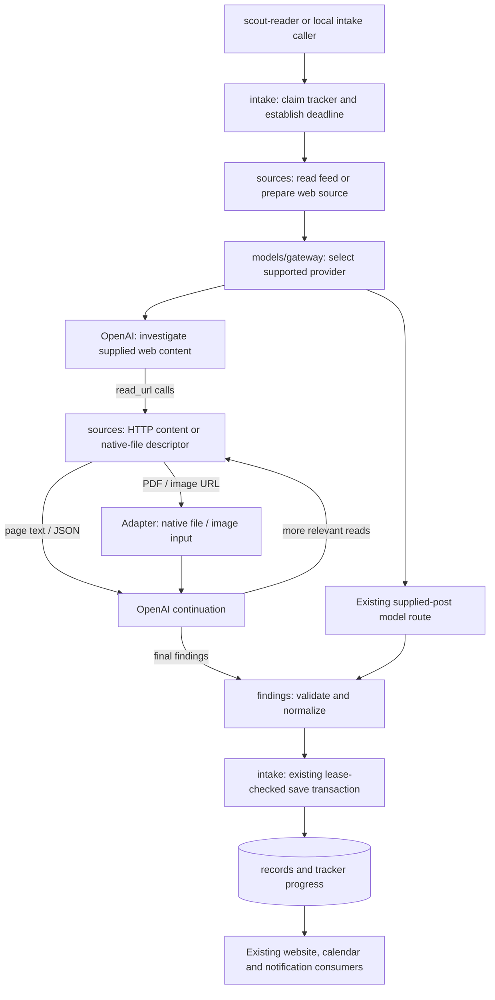

# Source-reading implementation architecture

**Status:** proposed implementation, prepared on 16 November 2026 against the
current checkout. This document expands the [source-reading proposal](event-source-reading-research-2026-11-09.md)
into file responsibilities, interfaces and an implementation sequence. It does
not describe deployed behavior. [architecture.md](architecture.md) remains the
description of the current system.

## Required result

Starting with a tracker URL, Scout must read the source's actual content,
discover relevant detail pages and documents, and extract the supported findings
within the existing tracker check. Investigate the directory's entries and use
each session's schedule rather than its parent conference's dates. Save useful
findings even when some entries or scheduling facts are missing. Keep supported
programme starts; leave unsupported or malformed scheduling values null and
report observed read/format problems in invocation diagnostics.

**Latest scope decision:** incomplete directory coverage, broken linked
documents and conflicting/incorrect dates must not block saving other findings
or advancing the check. Cleanup and follow-up for missing, incomplete or
incorrect findings are a separate future task, outside this implementation.

The implementation extends `reader/` inside the existing `scout-reader` Supabase
function. HTTP retrieval belongs to the source reader; model-directed
investigation and native document inputs belong to the OpenAI adapter; intake
continues to own the deadline, progress and saving. There is no separately
deployed retrieval or discovery service. Retrieval uses HTTP and provider-native
inputs, without browser rendering, a separate PDF parser or an OCR service.

## Current ingestion pipeline and the changes

| Boundary | Current implementation | Proposed change |
| --- | --- | --- |
| Entry and claim | `hostedReader()` calls `intake()`, which atomically claims one tracker for 120 seconds. | Preserve claim ownership and authentication; test and adjust the lease with the investigation and caller timeouts. |
| Source reading | `readSource()` paginates Bluesky feeds into supplied posts. Other URLs become `{url, at}` without fetching the page. | Supply prepared web content as well as the URL. Mark web and post inputs explicitly. |
| Provider selection | `trackerModel()` normally tries Gemini, then OpenAI for eligible failures. | Route web investigations directly to the adapter implementing linked reads and native document inputs. |
| Model investigation | Gemini enables URL Context. OpenAI makes one Responses request with built-in web search; it rejects custom function calls. | Extend OpenAI with a `read_url` function and an invocation-local continuation loop. Keep web search for targeted official alternatives. |
| Instructions | Any `input.content` is described as a single social-media post. | Use the explicit source kind to apply webpage/directory or post scope. |
| Validation | `normalizeFinding()` silently converts malformed dates, clocks and zones to null. Gateway and intake both use it. | Keep valid fields and normalize unusable optional scheduling values to null, with invocation diagnostics. A bad optional value must not reject the finding or check. |
| Saving | Intake normalizes findings, checks the lease and URL, then saves the source-date group and cutoff in one transaction; an ambiguous match rolls back the group. | Keep transaction and matching ownership. Skip the affected ambiguous/conflicting finding, save the others and advance progress. Retrieval happens before saving. |

The current instructions already classify past gatherings as events. That rule
is retained; the historical audit's warning about that classification does not
require another implementation path.

## Nonblocking collection; cleanup is out of scope

| Content issue | Behavior in this implementation |
| --- | --- |
| Directory entries are missed or incompletely read | Save the returned useful findings and complete the check. No completeness gate, automatic replay or provider fallback solely to obtain full coverage. |
| A linked document cannot be read | Return a read error to the model, use available evidence and continue with other material. Missing optional facts remain null. A broken document must not reject the other findings. |
| A source's date is unresolved or contradictory | Use supported facts and leave the unresolved field null. Do not guess a correction. |
| A model supplies a malformed optional scheduling value | Normalize that field to null, retain other useful fields and expose the format issue in invocation diagnostics. |
| A finding conflicts with an existing saved date or has an ambiguous match | Reuse `saveFindings()`'s existing skip-and-count behavior for that finding; keep the existing record unchanged, save other findings and advance progress. Remove intake's group-level throw on `result.ambiguous`. |

Use the existing response, counters and invocation diagnostics for observed
limitations; do not add a stored partial/completeness state, cleanup queue,
follow-up job, repair routine or missing-document history. Advancing the cutoff
means this collection attempt is consumed, not that every entry or document was
read. These quality issues must not hold the cutoff or cause automatic replay.
Do not claim that diagnostics detect every missing entry or plausible wrong date.

Actual operational failures still require the existing safe behavior: for
example, unavailable primary content with no usable evidence, an unparseable
model response, provider outage, expired lease or failed SQL cannot produce a
valid committed result. Preserve transaction rollback for failed writes and lease
ownership checks. This does not make the content issues above run-level failures.

The arrows inside the investigation represent work within one check, not durable
processing stages. A model continuation is another provider request, but not a
new tracker claim or an independent extraction job.

## Files to modify or extend

| File | Implementation responsibility |
| --- | --- |
| [reader/sources.js](../reader/sources.js) | Extend `readSource()` for web inputs; add the reusable `readUrl()` operation in this same module. Prepare HTML/JSON, resolve links and images, map the verified CBD content endpoint, classify native documents and reuse invocation-local fetches. Keep existing feed pagination and timestamps. |
| [reader/intake.js](../reader/intake.js) | Create the per-check URL cache and deadline-bound reader; pass it to source preparation and `modelFor`; include `source_kind` in model input. Tune the check budget and lease from measurements. Keep grouping and atomic save/progress updates, but remove the group-level failure on an ambiguous/conflicting finding. |
| [reader/models/openai.js](../reader/models/openai.js) | Add the URL-read function definition, dispatch calls, construct native inputs and isolate document-specific failures so other evidence can produce findings. Preserve stateless context, response-shape validation and sanitized errors. Accumulate numeric request/usage measurements in existing invocation diagnostics. |
| [reader/models/gateway.js](../reader/models/gateway.js) | Pass the reader to OpenAI and choose that adapter for web investigation. Preserve the supported post route, finite eligible fallback and shared deadline. Keep response validation; optional scheduling defects and partial coverage must not reject an otherwise usable answer or trigger fallback. |
| [reader/instructions.js](../reader/instructions.js) | Distinguish web and post scope; specify directory coverage, relevant documents, first-day programme starts, evidenced timezones and contradictory-source handling. Keep the eight finding fields and priority rubric. |
| [reader/findings.js](../reader/findings.js) | Keep field-level scheduling normalization and make malformed optional values visible in invocation diagnostics. Reuse existing matching, merging, conflict skips and save SQL; do not add automatic date repair. |
| [supabase/functions/scout-reader/index.ts](../supabase/functions/scout-reader/index.ts) | Extend the existing `modelFor` callback to forward the reader supplied by intake. Keep the endpoint and credentials unchanged. |
| [diagnostics/diagnose-tracker.js](../diagnostics/diagnose-tracker.js) | Forward the same reader through its `modelFor` callback so local diagnostics exercise the same implementation. Do not broaden its existing capture exception. |
| [diagnostics/run-reader.js](../diagnostics/run-reader.js) | Adjust the hosted-call timeout if measurements require a longer check; it must allow the endpoint to finish or report failure. |
| [supabase/scout-loop.sql](../supabase/scout-loop.sql) | Adjust collection's `net.http_post` timeout if required. Apply any deployed `loop_tick` change through a focused SQL migration, preserving each job's prior active state and leaving notification timing alone. No table change is needed. |
| [package.json](../package.json), [package-lock.json](../package-lock.json), [scout-reader/deno.json](../supabase/functions/scout-reader/deno.json) | Add and pin one HTML parser consistently for Node and the hosted runtime, as described below. |
| [tests/reader.test.js](../tests/reader.test.js) | Add meaningful source-preparation and transaction cases; adapt existing web tests to supply mocked source HTTP rather than making real network requests. |
| [tests/model-gateway.test.js](../tests/model-gateway.test.js) | Cover provider routing, function-call continuations, native inputs, read errors, deadlines and malformed scheduling output. |
| [tests/local-diagnostics.test.js](../tests/local-diagnostics.test.js) | Update the existing diagnostic integration case for the forwarded reader and web route. |
| [docs/architecture.md](architecture.md), [diagnostics/README.md](../diagnostics/README.md) | Update after implementation to describe the actual provider route and reading behavior. |

[reader/models/contract.js](../reader/models/contract.js) already defines
`invalid_output`, `model_unreadable`, `url_retrieval_failed` and `runtime_bound`.
Reuse those reasons; no new error taxonomy is planned.
[reader/models/gemini.js](../reader/models/gemini.js),
[reader/database.js](../reader/database.js), the record schema, scheduler cadence,
website, calendar and Slack implementation need no functional changes for this
proposal. A caller-timeout adjustment may require the focused function migration
listed above; it does not require a schema change or scheduler reinstall.

## Source-reader interface

Keep `readSource()` as the producer of source items with `url`, `at` and optional
`content`. Add `source_kind: 'web' | 'post'`. For an ordinary web tracker it still
returns one item dated at the check's `through` value. A directory's detail pages
are evidence for that item, not additional intake items or separate save groups.
Bluesky retains its individual post URLs, content objects and source-date groups.

Add one source operation, `readUrl(url, {fetch, signal, cache})`, used by both
initial web preparation and linked reads. It returns
`{url, media_type, content?}`: readable HTML/text uses a content string, JSON uses
its structured content, and native-file descriptors omit the body. The materials
are prepared as follows:

| Material | Prepared result |
| --- | --- |
| HTML or readable text | Public source URL, media type and readable text with inline absolute links, image references, captions and schedule structure. |
| Content-bearing JSON | Public source URL, media type and the actual structured content; HTML fields receive the same preparation as HTML pages. |
| PDF | Public URL and `application/pdf` descriptor; no downloaded file body. |
| Supported image | Public URL and image media-type descriptor; no downloaded image body. |

These are transient JavaScript values, not database records. Keep links next to
the headings, paragraphs, table rows and image descriptions that establish their
meaning. Do not flatten an agenda into an unordered bag of URLs or discard the
association between a directory entry and its detail link.

Intake owns a `Map` for the invocation and creates the reader closure using
`sourceFetch` and its absolute deadline. `readSource()` receives that reader;
`modelFor(source, {deadline, readUrl})` receives the same closure. Both hosted and
diagnostic callers forward it through `trackerModel()` to the OpenAI adapter.
Source HTTP continues to use `sourceFetch`; model HTTP continues to use the
adapter's injected fetch. This keeps the current testing boundaries intact.

Cache pending and completed reads by resolved URL, removing fragments while
preserving query parameters. Repeated parallel requests for the same URL reuse
one fetch. Reuse redirected results within the invocation, while preserving the
public URL associated with the source. Discard the cache when intake ends.

### HTML preparation and CBD content

Use a real HTML parser in `sources.js`. There is no existing parser in Scout;
regular-expression tag stripping would lose nested anchors, image descriptions
and table structure needed by these sources. The proposed dependency is
[parse5](https://parse5.js.org/), an HTML parser. Pin one version after checking
Node and Supabase/Deno compatibility; keep extraction in the existing module
rather than adding a parsing service or source-plugin system.

Preserve content-bearing structured data before removing executable scripts,
styles and page chrome. Keep meaningful headings, lists, table row/cell
boundaries, text, links and images. Prefer the page's main/article content where
identified. Do not truncate a populated directory, agenda or JSON response to
fit a Scout-defined content allowance.

For CBD, the audit found that the public conference page is an application shell
and that `/api/v2017/articles` supplies its article content. Add one concrete
mapping in `sources.js` for the verified routes. The mapping must select the
article belonging to the requested public page, preserve that page as the source
URL, and resolve article-relative links against the public page. Do not select
unrelated articles merely because they share a conference tag.

The exact endpoint query, article selector and detail-page response shape remain
an implementation prerequisite: the research note did not establish them. Verify
the overview and one agenda before coding that mapping. Store neither article
IDs for the 13 audited events nor a maintained list of programme URLs. An
unresolved shell or failed article lookup is a read failure, not an empty source.

Before handing a PDF/image URL to OpenAI, make a bounded request to verify the
HTTP response and inspect its headers; cancel a native-file body instead of
downloading it. This uses the same `readUrl()` path and invocation cache even
when the extension identifies the type. A broken linked document becomes a
failed read result and does not enter the native-input batch. Unsupported
responses, malformed JSON and HTTP failures remain explicit read errors without
rejecting other linked reads. Requests
accept public HTTP(S) URLs, reject credential-bearing/non-web URLs and do not
forward model or database credentials to sources. Enforce public destinations
for resolved addresses and redirect targets too; accepting an HTTP scheme alone
does not exclude loopback, private or link-local destinations.

## OpenAI investigation loop

Keep the current model and Responses endpoint. Replace the single serialized
input string with an input-item array so the request can contain supplied text,
native files/images, returned model items and function outputs.

Expose one function, `read_url`, with a strict object argument containing one
required string `url` and no additional properties. Multiple independent
function calls in one response can run together. There is no separate tool for
each website, event or document type.

The adapter performs this loop:

1. Send the supplied source, `source_kind`, current date, instructions, strict
   findings format and available tools. Prepared content means browsing is
   optional; stop requiring a web-search call merely to prove that a page was
   read by Scout.
2. Inspect response items by type. Validate `read_url` function names, arguments
   and URLs before executing the injected reader. Unknown operations remain
   `unexpected_tool`; malformed arguments are invalid output.
3. Return each result under its matching `call_id`. Page/JSON reads return
   readable content. PDF/image descriptors become the native inputs below.
   Return read errors as errors, with their URL and reason, rather than empty
   content; continue with other results. An aborted deadline terminates the
   attempt immediately.
4. Append the returned model items and function results to invocation-local
   history, then continue with the same instructions, schema and deadline.
   Batch the results of independent reads into one continuation. A repeated read
   can refer to already supplied material rather than inserting its body again.
5. Accept a final answer only when no function calls remain unresolved. Apply
   the existing provider finish/refusal/truncation checks and gateway finding
   validation. Discard the history after the check.

OpenAI documents function-result arrays containing text, images or files in its
[function-calling guide](https://developers.openai.com/api/docs/guides/function-calling)
and [Responses reference](https://developers.openai.com/api/reference/resources/responses/methods/create).
Use those native representations instead of putting a file URL in a text string
and assuming the provider opened it:

| Material | Content part returned to the model |
| --- | --- |
| PDF | `{type: 'input_file', file_url: url}` |
| Image | `{type: 'input_image', image_url: url, detail: 'auto'}` |

Include a text label carrying the source URL with each native result. The same
conversion applies when the tracker URL itself supplies a native document.
OpenAI's [file-input guide](https://developers.openai.com/api/docs/guides/file-inputs)
describes PDF text and page-image processing; the
[vision guide](https://developers.openai.com/api/docs/guides/images-vision)
describes image URL inputs. Selected-model support and access to the actual
audited files still require live validation. Creating a descriptor is not proof
that OpenAI successfully processed its contents.

If OpenAI rejects a native URL that passed Scout's HTTP check, handle that
document-specific rejection locally: remove the rejected native input, replace
its tool result with a read error and make one recovery continuation using the
other supplied evidence. If the provider identifies only a failed native batch,
treat that batch as unreadable instead of bisecting it or aborting the check.
Do not resubmit failed documents in the same invocation. This recovery shares
the deadline and must be verified against the provider's actual error response;
it does not suppress authentication, quota or other general provider failures.

Keep `store:false` on every request. Carry the required response items, including
reasoning items and any encrypted reasoning content required for stateless
continuation, in memory. Do not rely on a stored conversation or
`previous_response_id`. This follows OpenAI's
[stateless continuation guidance](https://developers.openai.com/api/docs/guides/migrate-to-responses).
The source text appears once in the logical history, although replaying that
history can incur input tokens on successive requests.

Retain built-in web search as an optional tool for a particular development's
missing or broken official link and independent corroboration. Search results
alone do not establish that a visual programme or flyer was read. Preserve
existing retrieval diagnostics without describing every search citation as a
completed Scout HTTP read.

### Final response and read failures

The shared `RESPONSE_SCHEMA` remains the array of eight-field findings. Extend
OpenAI's existing transport wrapper from `{records}` to `{status, records}`,
using the statuses intake already understands: `found`, `none`, `unreadable`.
The adapter supplies the wrapper-specific instruction and converts it to the
existing gateway answer shape. This is transport metadata, not a record field.

`found` accepts useful findings from partial evidence, with missing optional
facts left null. A broken document or incomplete directory must not turn those
findings into `unreadable`. `none` carries no returned findings and is accepted
without a directory completeness gate; it is not proof that no entries exist.
Reserve `unreadable` for an entire source investigation with no usable evidence,
which retains the existing operational failure path. Keep failed linked reads
visible in invocation diagnostics. An official alternative may be read within
the remaining budget, but it is not required before saving other findings.

Preserve the discovered directory and its entry/link associations in model
context, and instruct the model to address each principal entry. Measure
coverage against the audited directory and report omissions during validation.
Do not reject or replay a check because coverage is incomplete. There is no
runtime coverage matcher or completion threshold in this implementation; later
cleanup and follow-up are out of scope.

## Provider routing, deadline and validation

Use a direct source-kind decision in `gateway.js`, not a capability registry:

| Input | Default route | Fallback behavior |
| --- | --- | --- |
| Web page/directory or native web document | OpenAI with the reader and continuation loop. | No fallback to the current Gemini adapter, which lacks this investigation loop. |
| Supplied Bluesky post, with its existing scope | Existing Gemini attempt. | Existing one OpenAI fallback for eligible errors; supply the reader to that adapter too. |
| Explicit diagnostic provider | Requested adapter only. | No fallback, as today. Reject Gemini for a web investigation before dispatch. |

Google's [URL Context documentation](https://ai.google.dev/gemini-api/docs/url-context)
states that supplied URLs do not cause nested links to be retrieved. Do not spend
the first 45 seconds of a web check on an adapter that cannot perform the
required investigation. This change adds recursive reading to the OpenAI route;
it does not claim to add it to the supplied-post Gemini route. Do not invent an
OpenAI-to-Gemini fallback or a same-provider retry to preserve an attempt count.
Existing eligible-error fallback remains finite wherever the next adapter
supports the input. Missing/malformed optional scheduling values, incomplete
coverage and broken linked documents do not trigger provider fallback.

### Timing must be measured and adjusted

The current 100-second investigation budget and 120-second lease are starting
values, not acceptance requirements. The user reports earlier timeout failures;
this review has not reproduced or attributed those failures. Test the revised
path and select timings from measured source reads, model rounds and total
hosted latency rather than preserving the existing constants or arbitrarily
increasing only the lease.

| Timing boundary | Current value | What to verify or adjust |
| --- | --- | --- |
| Intake investigation budget | 100 seconds from `last_checked_at` | Enough for initial retrieval, linked reads and all model continuations, with time left to save or report failure. |
| Gateway attempt ceiling | Gemini 45 seconds; OpenAI 100 seconds, also limited by the check deadline | Remove a stale OpenAI ceiling if the chosen check budget is longer. Keep each attempt within the same absolute check deadline. |
| Tracker lease | 120 seconds | Must cover processing through the last transaction and failure cleanup, including notifications between Bluesky groups. Longer ownership alone adds no usable model time. |
| Scheduled HTTP request | 120 seconds in `scout.loop_tick()` | Must allow the hosted response; a caller timeout does not prove that server processing stopped or rolled back. |
| Manual hosted caller | 125 seconds in `diagnostics/run-reader.js` | Align with the tested endpoint duration and response overhead. |
| Hosted database | 5-second connect and per-statement timeouts | Reserve time for connection, lease checks, advisory-lock waits, save queries and cleanup. A statement timeout does not bound an entire transaction. |
| Post-commit delivery | Sequential messages spaced at least one second apart | Include this in total endpoint duration. Final delivery occurs after saving; failure or client timeout must not replay collection. |

Supabase currently documents a **150-second worker lifetime on Free**, a
**150-second request idle timeout**, **2 seconds of CPU per request** and
**256 MB memory** in its [Edge Function limits](https://supabase.com/docs/guides/functions/limits).
These are platform constraints, separate from Scout's lease. Verify the actual
project plan and effective runtime limits before choosing values; a local test
does not establish hosted capacity. A lease above 120 seconds may be useful, but
a 180- or 300-second synchronous check cannot be assumed to fit this deployment.
The existing $0/month constraint remains.

Keep one absolute investigation deadline per check. Initial fetching, CBD
endpoint reads, linked requests, model calls and native processing all consume
its remaining time. Bound an individual read so a stalled site can return an
error while time remains to investigate an official alternative. Continuations
must not restart the clock. Choose a lease that outlasts processing and cleanup;
choose caller timeouts that allow the response, within verified platform limits.
Reserve measured time outside investigation for startup, SQL, post-commit
delivery and response completion. Do not add lease renewal or background work
merely to avoid tuning these bounds.

Implementation acceptance includes:

- Measure one real record first, then the complete CBD directory and native
  document cases. Measure source preparation, each model round, save duration
  and total response time; include hosted startup and delivery overhead in a
  separately authorized hosted check. Use a small bounded repeat to observe
  variability without claiming a reliable latency percentile from a few runs.
- Reproduce the relevant timeout boundary where possible and distinguish an
  application abort, stale lease, caller timeout, platform timeout and CPU or
  memory termination. Check parser CPU/memory as well as network wait time.
- Exercise slow HTTP, a slow continuation and a near-expiry save with mocked
  mechanics. Confirm cancellation, lease exclusion, rollback of an unfinished
  group, retained earlier checkpoints and no duplicate save after a timed-out
  caller. Separately measure the real model and hosted behavior.
- Adjust the investigation budget, gateway ceiling, lease and affected callers
  together, then rerun the same acceptance cases. Leave demonstrated headroom
  for SQL and failure reporting; do not run the model to the platform deadline.
- If the complete check still cannot fit the verified runtime and account
  allowance, report the measured bottleneck before proposing another execution
  model. More time, higher reasoning or a queue is not an assumed fix.

Keep finite provider attempts and actual runtime bounds, without adding Scout
URL, tool-count or content allowances. Final timeout values remain undecided
until these tests are complete.

### Scheduling validation

In `normalizeFinding()`, retain the existing field-level conversion of malformed
optional scheduling values to null, and expose observed format issues through
invocation diagnostics. A malformed date, deadline, clock or zone must not reject
the rest of the finding or the check. Preserve valid values unchanged; continue
accepting real `YYYY`, `YYYY-MM`, `YYYY-MM-DD` dates, existing `HH:MM` / `HH:MM:SS`
clocks, validated UTC/offset/IANA zones and deliberately null values. Keep
response-shape and useful-description validation. Do not add a natural-language
time parser, field dependencies or a repair step.

Instructions must explicitly select the first event day and that day's programme
start, separate registration/doors/later sessions/ceremonies, keep multi-day
gatherings as one event, convert UTC timestamps using evidenced timezone context,
and seek independent official evidence for contradictions. Preserve the
different meanings of event, announcement and treaty-action dates.

## Persistence and cost

The save boundary does not move. Final validated findings pass to the existing
lease-checked transaction, advisory lock, candidate matching, merge and tracker
checkpoint. Persist the intake item's source URL as today; linked material is
reading evidence, not a new per-finding provenance contract. The existing
`sources` array remains; this proposal does not add a model-returned source
mapping or automatically attach every investigated URL to every finding.

Identical findings still make no finding writes. For conflicting dates or
ambiguous matches, keep `saveFindings()`'s existing skip-and-count behavior, but
remove intake's `if(result.ambiguous) throw ...` escalation. The affected record
stays unchanged; unrelated findings and tracker progress commit together. Do not
add per-field conflict merging or automatically repair the 22 audited records.
An all-conflict result still advances progress with no finding writes. Observed
ambiguity counts return to the caller; they do not create a cleanup queue.
Earlier committed Bluesky groups remain saved if a newer group has an actual
operational failure. Existing post-commit notification behavior remains, but
validation runs use no delivery callback.

Expected cost before measurement:

| Activity | Estimate |
| --- | --- |
| Web model requests | One initial request plus one continuation per returned batch of custom read calls; a document-specific provider rejection can add one recovery continuation for its failed native batch. A root-only extraction can take one request. No fixed request per event or document. |
| Source HTTP | One initial source read, mapped content requests, distinct linked page reads and native-document header checks requested by the model. Repeated URLs reuse in-memory results. Provider-native document body fetches are separate from Scout HTTP. |
| Successful nonempty web save | `6 + N + W` SQL statements for `N` distinct findings processed, including skipped conflicts, and `W` inserted/updated findings, excluding notification queries and test setup. One new finding: 8 statements and 3 row mutations. |
| Identical one-finding repeat | 7 SQL statements and 2 tracker mutations; zero finding mutations. |
| Valid empty web result | 5 SQL statements and 2 tracker mutations. |
| Failure before saving | Normally claim plus failure update: 2 statements and 2 tracker mutations, subject to lease validity. |
| Retained source/model bytes | Zero. New retained bytes are only useful finding rows/URLs and updates to existing tracker state; measure their actual row size. |
| Daily work | For `T` due web checks, sum each check's initial request and continuation rounds; post checks retain their feed-dependent counts and eligible fallback. No extra polling or recurring job is introduced. |

These are code-path estimates, not measured live results or a monetary quote.
Return aggregate request counts, provider usage when supplied, source byte
counts and elapsed time through invocation diagnostics; use `database().metrics`
for SQL measurements. Do not store traffic, a usage ledger or an operation
history. Verify actual shared account allowances and charges before live probes
and unattended use of the revised reader; the design must fit the existing
$0/month stack.

## Review issues and the chosen behavior

| Issue | Required resolution |
| --- | --- |
| A valid but partial directory answer can still advance progress. | This is accepted collection behavior. Measure coverage against the audit and verify that omitted entries and an empty answer do not cause a coverage failure or replay. Add no completeness gate or follow-up machinery; cleanup is a later task. |
| A known PDF/image URL can fail when OpenAI fetches it. | Verify HTTP status before constructing native input, then handle any document-specific provider rejection locally as described above. Test that useful findings still save and progress advances without the broken material. No mandatory alternate search, document bisection or download/upload fallback. |
| Removing scripts can discard published event data. | Preserve content-bearing structured data, such as [event JSON-LD](https://schema.org/startDate), before removing executable scripts. Verify preparation retains dates, table structure and source associations; fetching HTML is not enough. |
| More accurate extraction can conflict with existing saved dates. | Change intake to accept the existing per-finding conflict skips and counts. Test that the conflicting record stays unchanged while other findings save and progress advances, including an all-conflict result. Automatic correction remains outside this task. |
| The web route changes account consumption and failure recovery. | Web checks move directly to OpenAI and have no capable Gemini fallback. Measure actual allowance use, repeated-history tokens and visual-document input cost before unattended use; preserve explicit rate/auth/context failures rather than declaring the alternate provider a safety net. |

The public-destination checks above also need a concrete implementation and
redirect tests: the new tool executes URLs selected from untrusted page content.
These decisions add no cleanup, coverage enforcement, repair pipeline or
broader persistence/retry framework. Future follow-up is intentionally deferred.

## Implementation sequence and acceptance

1. **Resolve the concrete source boundary.** Verify CBD's overview and one agenda
   API mapping in memory; check the selected parser in Node and the hosted
   runtime. Establish that the directory entries, linked schedules and relative
   URLs survive preparation. No raw source fixtures or captures need be saved.
2. **Implement the web path as one vertical change.** Extend sources, intake,
   OpenAI continuation, gateway routing and the two `modelFor` callers. Update
   instructions and field-level scheduling diagnostics; remove intake's
   ambiguous-finding escalation. Keep new code in the files above; add no tables,
   jobs, coverage gate, cleanup setup, generic plugin framework or helper scripts.
3. **Verify mechanics with existing test patterns.** Use small synthetic content
   in the existing tests. Cover relative links and agenda structure; CBD shell
   resolution; repeated-read reuse; parallel call/result association; native
   input construction and recovery from a rejected native document; malformed
   operations; failed reads versus empty content; shared timeout; and nonblocking
   normalization of malformed optional scheduling values. Use the existing
   PGlite setup to prove that partial coverage, broken documents and conflicting
   dates do not block other saves or progress, while real SQL/lease failures
   still roll back safely. Verify an identical repeat makes no finding writes.
   Mocked provider replies prove mechanics only.
4. **Prove one real extraction and save before expanding.** Start with audited
   record 2 through intake and an ephemeral database, using real source/model
   requests and no notifications. Expect `2026-10-24`, `10:00`, `Asia/Yerevan`.
   Keep expected answers outside model input. Measure requests, tokens, elapsed
   time, source bytes, SQL statements/mutations and retained row bytes. A mocked
   save or a focused extraction alone is not this end-to-end proof.
5. **Measure coverage and document-reading quality.** Compare with the
   [audit](event-date-time-audit-2026-11-08.md): 13 CBD entries and their first
   days, ten published starts and three justified nulls are the quality reference,
   not a runtime completion threshold. Report returned entries, supported facts
   and omissions honestly; save the useful findings even when incomplete. Check
   record 14's formal plenary versus separate ceremony and UN records 15–22,
   including the visual PDF header, image flyers and conflicting official dates.
   Verify a broken link does not block remaining findings. Expected schedules
   and a permanent audited URL list must stay outside model input. Cleanup or
   follow-up on gaps remains a separate future task.
   Complete the timing measurements and adjust the linked bounds above; the
   original 100/120-second values are not a reason to reject a necessary change.
6. **Review the actual diff and deployment package.** Remove unnecessary scope,
   update the current architecture/diagnostic docs, run the relevant existing
   tests and then the project suite. Use existing import-boundary checks to keep
   diagnostics out of hosted code. Verify the deployed parser import and source
   HTTP behavior when deployment is separately authorized. Follow
   [README → Supabase deployment](../README.md#supabase-deployment).

The remaining acceptance questions are the verified CBD mapping, native-file
failure isolation, nonblocking saves/progress, tested timeout/lease values,
hosted resource headroom and account cost. Measure directory quality without
adding a completeness gate or implementing cleanup in this task.
If the directory cannot complete within the existing runtime/allowances, report
that observed limit before proposing further machinery. Creating this document
does not authorize production record repair, deployment or changes to collection
and notification jobs. Check the current operational instructions and preserve
the required job state when a later deployment is authorized; this preparation
task changes no schedules or live operational state.
